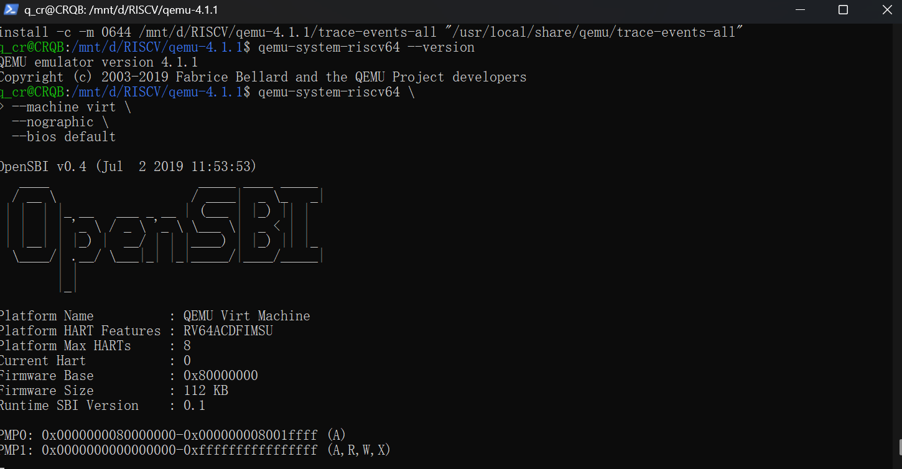
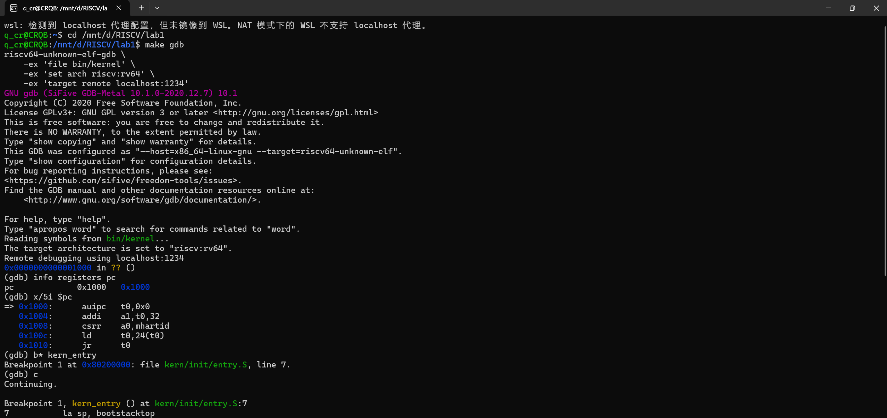
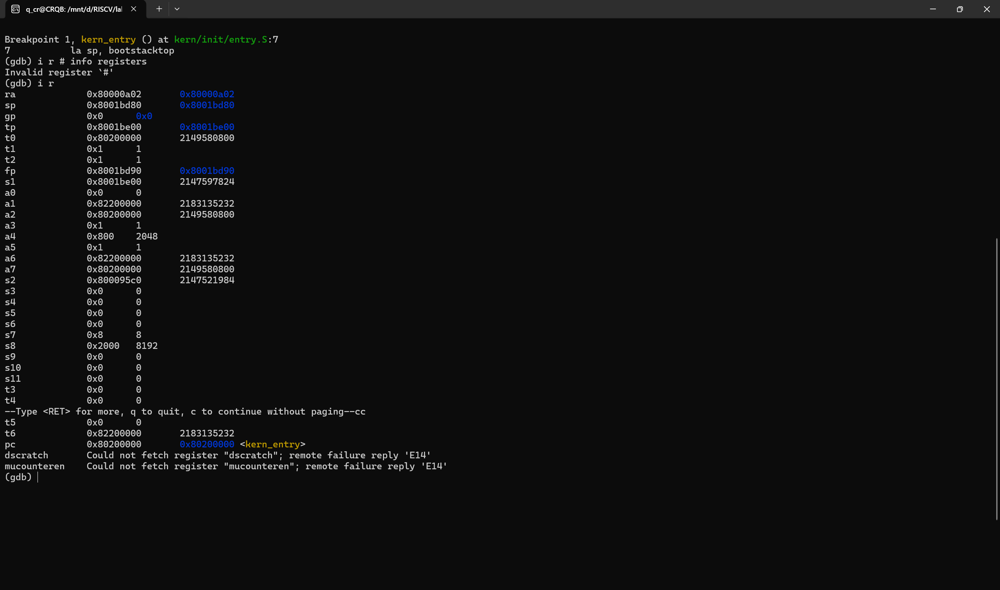

# 实验报告

## 实验基本信息

| 项目       | 内容                                 |
| -------- | ---------------------------------- |
| **实验名称** | Lab1: 比麻雀更小的麻雀（最小可执行内核）            |
| **小组成员** | 2512973-王璐璐，2512832-薛钧，2513803-钱承瑞 |
| **完成日期** | 2026-10-11                         |

### 小组分工

练习如何分工？

| 成员          | 负责的练习/模块 |
| ----------- | -------- |
| 2512973-王璐璐 | 练习一及练习二  |
| 2512832-薛钧  | 练习一及练习二  |
| 2513803-钱承瑞 | 练习一及练习二  |

实验报告如何分工？

| 成员          | 负责的版块             |
| ----------- | ----------------- |
| 2512973-王璐璐 | 实验目的，功能模块理解以及练习二  |
| 2512832-薛钧  | 练习一以及收获与总结填写      |
| 2513803-钱承瑞 | 实验整体逻辑与分析以及测试验证板块 |

---

## 一、实验目的

本实验的主要目的是：

1. 使用 链接脚本 描述内存布局
2. 进行 交叉编译 生成可执行文件，进而生成内核镜像
3. 使用 OpenSBI 作为 bootloader 加载内核镜像，并使用 Qemu 进行模拟
4. 使用 OpenSBI 提供的服务，在屏幕上格式化打印字符串用于以后调试
5. 加深对os原理知识的认识与理解

---

## 二、实验环境

你们使用的 AI 工具

| 成员          | AI 编程工具          | 底层模型                  | 备注  |
| ----------- | ---------------- | --------------------- | --- |
| 2512973-王璐璐 | vs code的claude插件 | deepseek v4 pro light | 无   |
| 2512832-薛钧  | vs code的codex插件  | GPT 6.0sol            | 无   |
| 2513803-钱承瑞 | codex            | gpt 6.1 sol           | 无   |

**说明：**

- **AI 编程工具**：指具体使用的终端工具、编辑器插件、桌面应用或浏览器界面
- **底层模型**：指该工具使用的大语言模型及版本

---

## 三、实验整体逻辑分析

### 2.1 本章节的逻辑主线

该实验主要围绕最小可执行内核和启动流程
该实验在 Qemu 模拟器上运行 64 位 RISC-V 计算机，了解kern_init,OpenSBI等原理，并用GDB调试开机流程

### 2.2 功能的逐步实现

首先了解kern_init等内核程序原理，为后续验证启动流程铺垫
接着用GDB调试开机流程，全面了解启动程序三部分程序的PC跳转以及作用原理

---

## 四、实验内容与实现

### 练习1：理解内核启动中的程序入口操作

**负责人：** 全员

（1）la sp, bootstacktop 将符号 bootstacktop 的地址写入栈指针寄存器 sp。入口代码已经预留了启动栈空间，bootstacktop 位于这块空间的高地址端。由于 RISC-V 的栈向低地址增长，将 sp 设置到这里，就为内核建立了可用的栈，以支持后续 C 函数执行时保存寄存器、局部数据和函数调用相关信息。

（2）tail是尾调用伪指令，tail kern_init 跳转到 C 语言编写的内核初始化函数 kern_init，不为此次跳转设置返回地址。其目的是在完成栈初始化后，将执行流程交给 C 代码。由于 kern_init 不会返回，使用尾调用符合这一启动流程。

### 练习2：使用GDB验证启动流程

**负责人：** 全员

（1）调试过程：

在第一个终端执行make debug，其中-S让虚拟CPU 启动后立即暂停；-s则令QEMU在本机 1234 端口等待 GDB 连接；在第二个终端连接 GDB执行make gdb，一次完成file bin/kernel   set arch riscv:rv64  target remote localhost:1234等命令GDB 连接后，程序停在：0x0000000000001000 in ?? ()，说明虚拟 CPU 复位后的初始 PC 是 0x1000；随后在内核入口设置断点：b *kern_entry ，断点地址为：0x80200000，并让程序继续执行：c，程序经过 QEMU 复位代码和 OpenSBI，最终在内核入口停止；通过命令info registers查看寄存器，观察到：pc = 0x80200000 <kern_entry> ，a0 = 0

a1 = 0x82200000，sp = 0x8001bd80

(2)观察结果：

QEMU 输出显示：Firmware Base : 0x80000000，说明复位代码执行后，会跳转到 0x80000000，开始运行 OpenSBI 固件；Breakpoint 1 at 0x80200000，pc = 0x80200000 <kern_entry>

说明 OpenSBI 最终把控制权交给位于 0x80200000 的内核入口 kern_entry，此时将要执行的内核第一条源代码指令是：la sp, bootstacktop

(3)练习2问题答案：

加电后最初执行的指令地址：0x1000

完成的功能：主要准备设备树地址和当前 hart ID等，读取 OpenSBI 的入口地址，并将执行流程转交给 OpenSBI，OpenSBI负责完成底层硬件和特权级初始化，最后把控制权交给 0x80200000 处的操作系统内核。

## 五、功能核心函数理解

lab1 的代码按"启动 → 初始化 → 输出 → 底层支撑"这条链路组织，核心模块如下：

1. 内核入口kern_entry（kern/init/entry.S）

整个内核的第一条指令所在。它只做两件事：la sp, bootstacktop建立内核栈，tail kern_init跳转到 C 入口。它的价值在于完成"从固件/裸机到 C 语言世界"的交接——C 函数依赖栈，栈必须在调用任何 C 代码之前就位。同时它是链接脚本 ENTRY(kern_entry)指定的 ELF 入口，决定了内核的第一条指令落在 0x80200000。

2. 内核初始化 kern_init（kern/init/init.c）

内核的 C 主函数。核心工作是三件：

（1）memset(edata, 0, end - edata)z:清零 BSS 段。edata、end是链接脚本导出的符号（见 tools/kernel.ld）,分别标记 .data结束和.bss结束。C 语言约定"未初始化的全局变量为 0"，但镜像里并不存储这些 0，必须在运行时由程序自己清零。

（2)cprintf("(THU.CST) os is loading ...\n")`：打印一行，验证整条输出链可用。

（3）while(1);死循环，本阶段内核没有调度器、没有后续任务，跑完就该停住。

3. 格式化输出链（kern/libs/stdio.c + libs/printfmt.c）

内核没有 libc，printf是手写的。这条链的分工是：

（1）cprintf（stdio.c）：用户侧入口，处理可变参数（va_start/va_end），转交 vcprintf。

（2）vcprintf（stdio.c）：调用 vprintfmt，并传入回调函数 cputch和计数器。

（3）vprintfmt（printfmt.c）：真正的格式化引擎，逐字符扫描格式串，解析 %d %x %s %c %p %u %o %%等，通过回调 putch输出。设计上它是"引擎与输出设备解耦"的典范：vprintfmt不关心字符最终去哪，只调用传入的putch；同一份引擎既能打印到屏幕（cputch），也能打印到缓冲区（sprintputch，供snprintf用）。

（4）cputch（stdio.c）：回调函数，调用cons_putc并计数。

4. 终端抽象cons_putc / cons_getc（kern/driver/console.c）

内核的"设备抽象层"。cons_putc把字符交给sbi_console_putchar`，`cons_getc从sbi_console_getchar读。上层的cprintf`/`getchar只跟cons_* 打交道，不直接碰硬件，这样将来换输出设备（图形、串口）时上层代码不用改。

5. SBI 调用sbi_call（libs/sbi.c）

输出链的最底层。核心是内联汇编执行 ecall指令：先把功能号放进x17（a7）、参数放进x10/x11/x12`，`ecall陷入到 OpenSBI，返回值取x10。这是"内核请固件代劳"的关键：内核运行在 S 态，没有权限直接操作串口等设备，必须通过ecall请求运行在 M 态的 OpenSBI。sbi_console_putchar就是 sbi_call(SBI_CONSOLE_PUTCHAR, ch, 0, 0)。

6. 基础运行库（libs/）

(1)memset（string.c）：lab1 里唯一真正用到的字符串函数，用于 BSS 清零；其余strlen/memcpy/...为后续实验预备。

(2)defs.h：手写的uint64_t`、`intptr_t`、`ROUNDUP/ROUNDDOWN`、`offsetof/to_struct等，替代标准库头文件。

(3)riscv.h：RISC-V 的 CSR 寄存器编号、指令编码、DEFAULT_RSTVEC 0x1000`、`DRAM_BASE 0x80000000等常量，以及read_csr/write_csr等内联汇编宏。

(4)error.h`、`stdarg.h:错误码与可变参数（stdarg.h直接套用编译器 __builtin_va_list）。

7. 链接与内存布局（tools/kernel.ld + kern/mm/*.h）

(1)kernel.ld`：`OUTPUT_ARCH(riscv)` + `ENTRY(kern_entry)` + `BASE_ADDRESS = 0x80200000,然后按 .text → .rodata → .data → .sdata → .bss排布，并PROVIDE(etext/edata/end)导出边界符号。它决定了内核"被放到哪、入口在哪、各段怎么摆"。

(2)mmu.h定义PGSIZE = 4096`；`memlayout.h定义KSTACKSIZE = 2 页。

## 六、测试与验证

### 测试截图

## 七、收获与总结

### 对操作系统的理解

| 实验知识点                                                         | 对应 OS 原理              | 含义、关系与差异                                                                                                                                    |
| ------------------------------------------------------------- | --------------------- | ------------------------------------------------------------------------------------------------------------------------------------------- |
| **系统启动流程**（QEMU 加电 → `0x1000` 复位 → OpenSBI → `0x80200000` 内核） | 引导程序（bootloader）与系统启动 | 原理上"加电后固件/BIOS → 引导加载器 → OS 内核"；本实验里 bootloader 是 OpenSBI，且由 QEMU 预置（`-device loader`），并非从磁盘加载——是启动原理在一个模拟器上的具体化与简化。                        |
| **链接脚本与内存布局**（kernel.ld 的段排布、`0x80200000` 基址）                 | 程序装入内存、地址空间布局、ELF 装载  | 原理课讲"程序如何从可执行文件变成内存里的进程影像"；实验用链接脚本把内核各段摆到指定地址，是"装入/定位"最底层的实践。差异：此处是**物理地址直接定位**，尚无页表/虚拟内存，真正的地址映射要到 lab2/lab4。                              |
| **内核栈的建立**（`la sp, bootstacktop`）                             | 运行栈 / 栈帧、函数调用约定（ABI）  | 原理课中栈是函数调用、局部变量、保存现场的载体；实验在进入 C 代码前手动建立栈，把"栈必须在调用前就位"这一抽象约束变成了可见的汇编。                                                                        |
| **特权级与 ecall**（`sbi_call` 陷入 OpenSBI）                         | 用户态/内核态特权级、系统调用机制     | 原理上用户程序通过系统调用请求内核服务；实验里**内核（S 态）**通过 `ecall` 请求 **OpenSBI（M 态）**服务，是同一套"陷入 + 服务例程 + 返回"机制，只是发生在这两个更高的特权级之间。理解了它，就理解了 lab5 用户进程 syscall 的雏形。 |
| **硬件抽象**（`cons_*` 终端层、SBI 接口）                                 | 设备驱动、硬件抽象层（HAL）       | 原理上 OS 通过驱动屏蔽硬件差异；实验里用 `cons_putc` + SBI 把"打印一个字符"层层抽象，上层不感知串口细节，体现了"分层"思想。                                                                 |
| **交叉编译**（riscv64-unknown-elf-gcc）                             | 编译、汇编、链接、装载           | 原理课关注的是"源代码如何变成可执行映像"；实验亲手跑通"交叉编译 → 链接脚本 → objcopy 成二进制镜像"全流程，是把编译原理落到具体工具链上。                                                               |

---

### OS 原理中很重要、但本实验未覆盖的知识点

lab1 只是"最小可执行内核"，以下原理暂未涉及：

1. **进程 / 线程管理**：PCB、进程状态、上下文切换、调度算法（RR、stride）——对应后续 lab4、lab6。
2. **内存管理**：分页 / 分段、页表、虚拟内存与地址翻译、内存分配算法——对应 lab2、lab4。
3. **中断与异常处理**：中断向量表、时钟中断、中断开关、上下文保存与恢复——对应 lab3。
4. **同步与互斥**：信号量、管程、锁、死锁、临界区——对应 lab7。
5. **文件系统**：VFS 抽象、SFS 磁盘布局、文件打开/读写、设备管理——对应 lab8。
6. **页面置换与内存映射**：缺页异常、FIFO/LRU 等置换算法、mmap——对应 lab9。
7. **并发与原子性**：多核下的原子操作、内存序（lab1 的 `riscv.h` 里已可见这些指令编码，但尚未使用）。

### AI 协作开发的经验

在掌握一定专业知识的前提下，把AI当作高效但需要复核的合作伙伴，我们需要做好决策与质量把关，让AI承担好其他方面的任务，始终要以严谨的态度认真对待AI输出的产物。

---
