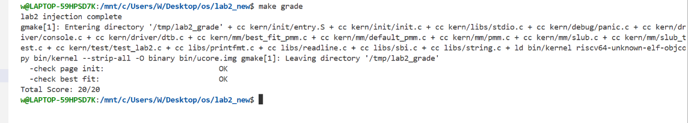
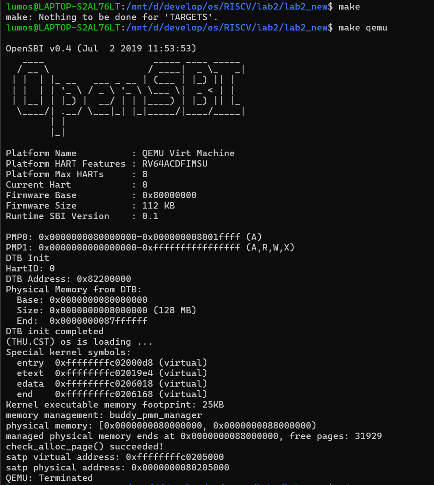
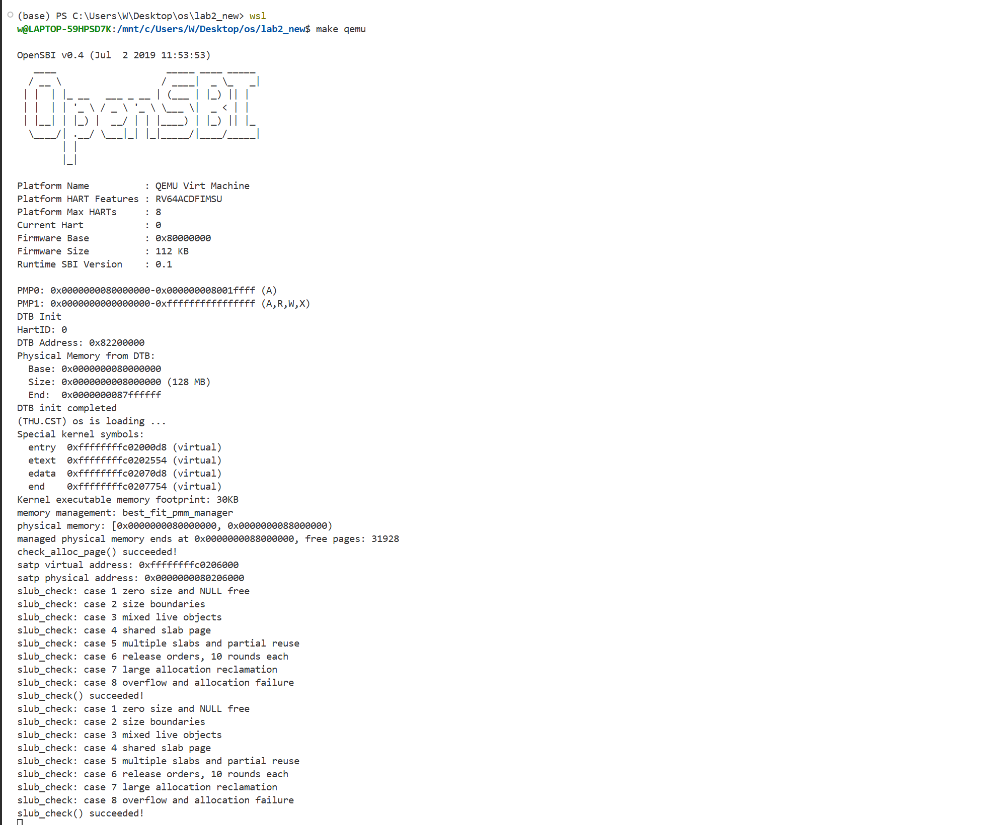
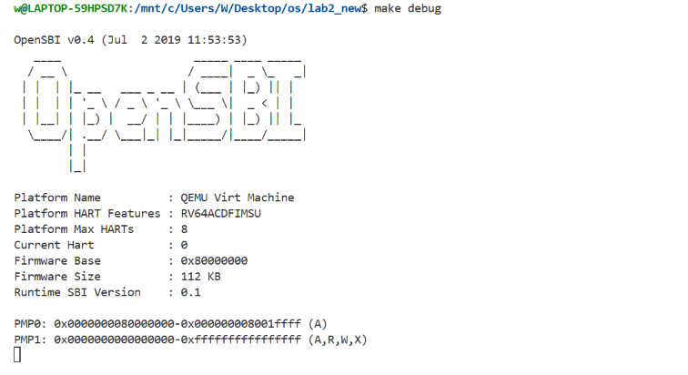
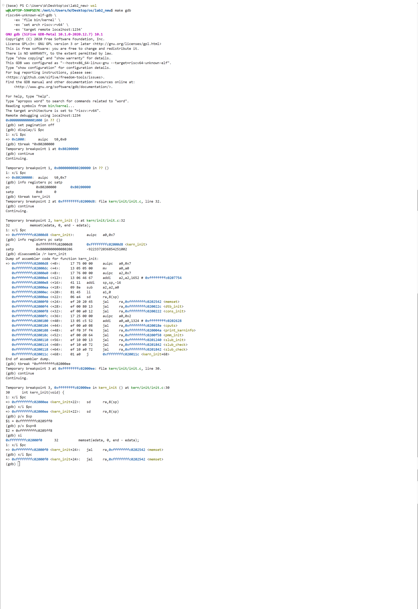
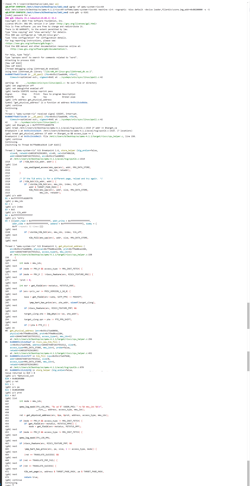

# 实验报告

## 实验基本信息

| 项目       | 内容                                 |
| -------- | ---------------------------------- |
| **实验名称** | Lab 2: 物理内存和页表                     |
| **小组成员** | 2512973-王璐璐，2512832-薛钧，2513803-钱承瑞 |
| **完成日期** | 2026-10-26                         |

### 小组分工

练习如何分工？

| 成员          | 负责的练习/模块                                                                          |
| ----------- | --------------------------------------------------------------------------------- |
| 2512973-王璐璐 | 任务二：实现 Best-Fit 连续物理内存分配算法+扩展任务Challenge：任意大小的内存单元 slub 分配算法                      |
| 2512832-薛钧  | 任务三：buddy system（伙伴系统）分配算法+扩展任务Challenge：任意大小的内存单元 slub 分配算法                      |
| 2513803-钱承瑞 | 功能模块一：物理内存初始化功能+功能模块二任务一：理解first-fit 连续物理内存分配算法+扩展任务Challenge：任意大小的内存单元 slub 分配算法 |

实验报告如何分工？

| 成员          | 负责的练习/模块                              |
| ----------- | ------------------------------------- |
| 2512973-王璐璐 | 功能模块二的Best-fit板块,challenge板块以及实验收获与总结 |
| 2512832-薛钧  | 功能模块二的2.buddy system以及测试与验证           |
| 2513803-钱承瑞 | 功能模块一，实验整体逻辑分析以及练习板块                  |


---

## 一、实验目的

<!-- 说明本次实验的主要目标和预期成果 -->

本实验的主要目的是：

2. 理解页表的建立和使用方法
3. 理解物理内存的管理方法
4. 理解页面分配算法

---

## 二、实验环境

你们使用的 AI 工具

| 成员          | AI 编程工具         | 底层模型         | 备注  |
| ----------- | --------------- | ------------ | --- |
| 2512973-王璐璐 | VS code的codex插件 | gpt-6.1sol轻度 | 无   |
| 2513803-钱承瑞 | cherry studio   | gpt-6.1sol   | 无   |
| 2512832-薛钧  | VS code的codex插件 | gpt-6.0sol轻度 | 无   |

**说明：**

- **AI 编程工具**：指具体使用的终端工具、编辑器插件、桌面应用或浏览器界面
- **底层模型**：指该工具使用的大语言模型及版本

---

## 三、实验整体逻辑分析

### 2.1 本章节的逻辑主线

本章实验围绕物理内存的发现、初始化与分配管理展开，并通过启动阶段的页表映射，使内核能够使用虚拟地址访问物理内存。

在 Lab1 中，内核已经能够启动并输出信息，但还没有建立完整的物理页管理机制，无法有组织地判断哪些内存可以使用，也不能按需申请和释放内存。因此，Lab2 要解决的核心问题是：如何在保护固件、内核及管理数据的前提下，将剩余物理内存组织成可分配资源，并支持后续的申请与回收。

实验主要包含两条相互配合的逻辑线：

地址映射：建立内核虚拟地址与物理地址之间的对应关系，解决“内核如何访问内存”的问题。
内存分配：探测 RAM 范围、建立物理页描述符、组织空闲块并实现分配与回收，解决“哪些内存可以使用，以及如何分配”的问题。
在此基础上，SLUB 扩展进一步在页分配器之上提供按字节大小申请对象的能力，减少小对象直接占用整页造成的浪费。整体主线可以概括为：

建立启动映射 → 获取物理内存信息 → 建立页描述符并划分保留区与空闲区 → 管理连续物理页的分配与回收 → 在页内实现小对象分配。

### 2.2 功能的逐步实现

1.首先建立启动页表和内核地址映射
  启动阶段由汇编入口准备页表并设置分页相关状态，使内核能够通过预定的高虚拟地址访问对应的物理内存，再进入 C 语言初始化流程。

这一步需要先完成，因为后续代码会通过内核虚拟地址访问全局变量、页描述符数组和分配得到的内存。只有地址映射与程序的链接布局相匹配，后续内存管理操作才有正确的访问基础。需要注意，这一阶段建立的是访问规则，还没有将物理内存登记为可分配资源。

2.接着获取硬件内存信息，并初始化物理内存管理器
  进入 C 语言初始化流程后，先解析设备树，取得 RAM 的起始地址与大小。随后，pmm_init() 选择当前的物理内存管理器，并初始化其内部管理结构，例如空闲链表和空闲页计数。

先获取硬件信息，是为了避免将内存范围完全写死，或把设备地址、地址空洞误认为可用 RAM。先初始化管理器，则是为了给后续空闲页登记准备好容器。

3.然后建立物理页描述符，登记真正可用的完整页
  page_init() 根据探测结果和框架支持的管理上限，确定可管理的物理内存范围，并在内核结束位置之后安排 Page 描述符数组。

初始化时，先将页描述符标记为保留，再排除 OpenSBI、内核镜像、描述符数组等占用区域。对剩余范围进行页面对齐后，通过 init_memmap() 将完整空闲页交给当前分配器管理。

这一步是后续分配的基础：如果没有正确区分已占用区域与空闲区域，分配器就可能把内核或描述符数组所在的页分配出去，导致系统数据被覆盖。 此外，描述符数组本身也占用内存，因此必须先确定其布局，再计算最终空闲范围。

4.在已有空闲页基础上，完成连续物理页的分配与回收
  空闲区域登记完成后，页分配器便可以处理连续物理页的申请与释放。本次使用并分析已有的 First-Fit 实现：它按照地址顺序组织空闲块，分配时从链表头寻找第一个足够大的块，必要时拆分；释放时按地址插回，并尝试与物理相邻的前后空闲块合并。

这一阶段形成了“登记空闲页—申请—使用—释放—合并”的基本闭环。拆分能够适应不同大小的连续页请求，合并则有助于重新形成较大的空闲块，缓解外部碎片问题。实验中的其他页分配策略也建立在相同的初始化结果和统一管理接口之上，但不必依赖 First-Fit 才能实现。

5.最后通过 SLUB 扩展，提供按对象大小分配的能力
  页分配器以页为单位工作，而内核中的许多对象远小于一页。如果每个小对象都单独申请一整页，会产生较大的空间浪费。因此，在底层页分配器可用后，再增加简化的 SLUB 对象分配层。

对于小对象，SLUB 向底层申请页，在页内划分不同规格的对象槽位，并复用释放后的槽位；对于较大的对象，则使用连续页容纳。一个 slab 中的对象全部释放后，将该页归还底层分配器。

必须将这一功能放在页分配之后，因为 SLUB 自身并不负责发现物理内存，而是依赖底层提供和回收页。通过不同大小申请、数据独立性、槽位复用、内存不足和释放后页数恢复等测试，最终验证两层分配机制能够配合工作，形成从整页管理到对象管理的完整流程。

---

## 四、实验内容与实现

<!-- 
说明：本部分按照 exercises 文档中的练习顺序组织
每个功能模块或者练习中可能包含多项任务，请根据实际情况调整
-->

### 功能模块：物理内存初始化功能

**负责人：** 2513803-钱承瑞

#### 模块功能描述

**需要实现/修改的函数：**

```c
// 列出本模块涉及的所有函数签名
static void page_init(void); (kern/mm/pmm.c)
```

**功能说明：**

- 该模块实现物理内存初始化功能，包括实现物理内存探测与页描述符初始化功能

#### 最终提示词

以下是经过迭代优化后，最终成功实现该功能的提示词：

```clike
[PROMPT]

任务：修改项目中的 kern/mm/pmm.c，在 lab2 function1 对应位置实现 page_init() 函数，完成物理内存探测结果的读取、物理页描述符初始化，以及初始空闲物理页的登记。

根据设备树提供的物理内存信息，建立可管理物理页的描述符布局，将排除 OpenSBI、内核镜像和描述符数组占用空间后的完整空闲页交给当前 pmm_manager 管理。

操作要求：必须修改项目中的实际文件，而不是仅展示代码。实现前阅读相关头文件和现有初始化流程，使用当前工程提供的接口、宏和数据结构。仅补充本任务需要的实现，不修改其他功能模块。

输出要求：保留文件中的现有代码和实验标记，将实现插入对应位置。完成后简要说明内存范围、地址转换、描述符布局和空闲页登记的处理方式；如果进行了编译或测试，如实报告结果，未验证的内容不得声称通过。

[RELY]

以下名称以当前工程中的实际定义为准，使用前检查相关头文件，不重复定义已有内容。

宏定义
C
/* 页面大小、页号与对齐 */
PGSIZE
PGSHIFT
PPN(pa)
ROUNDUP(a, n)
ROUNDDOWN(a, n)
/* 内存布局与管理范围 */
DRAM_BASE
KERNBASE
KERNEL_BEGIN_PADDR
PHYSICAL_MEMORY_END
PHYSICAL_MEMORY_OFFSET
/* 内核虚拟地址转换为物理地址 */
PADDR(kva)
/* 页面保留状态 */
SetPageReserved(page)
数据结构与相关全局变量
C
struct Page {
    int ref;
    uint64_t flags;
    unsigned int property;
    list_entry_t page_link;
};
extern struct Page *pages;
extern size_t npage;
extern const size_t nbase;
extern uint64_t va_pa_offset;
/* 链接脚本提供的内核结束符号 */
extern char end[];
其中：

pages 指向物理页描述符数组，保存的是内核虚拟地址。
nbase 是描述符数组对应的起始物理页号。
npage 是可管理物理页号的排他上界，不是描述符数量。
描述符数量应与 npage - nbase 一致。
va_pa_offset 表示当前内核直映区域的虚拟地址与物理地址之差。
可用函数
C
uint64_t get_memory_base(void);
uint64_t get_memory_size(void);
static void init_memmap(struct Page *base, size_t n);
static inline struct Page *pa2page(uintptr_t pa);
另外可使用框架提供的：

C
panic(...)
cprintf(...)
memset(...)
list_init(...)
init_memmap() 将指定的连续物理页交给当前内存管理器登记；调用前必须保证页数大于零，并满足该管理器对描述符初始状态的要求。

[GUARANTEE]

必须实现的接口：

C
void page_init(void);
该函数无参数、无返回值，由 pmm_init() 调用。如果遵循当前文件内部使用方式，可定义为：

C
static void page_init(void);
可以根据需要添加文件内部的辅助函数或局部定义，但不得修改已有公共接口，不得改变当前 pmm_manager 的选择。

[SPECIFICATION]

page_init
Pre-Condition：

内核已经进入初始化流程，pmm_init() 已选择并初始化当前物理内存管理器。
设备树初始化流程已执行，可以通过 get_memory_base() 和 get_memory_size() 获取解析结果；不得因此假定结果一定有效。
当前内核地址映射、物理内存管理上限和页面大小由工程已有宏定义。
链接符号 end 表示内核镜像布局结束处的虚拟地址。
Post-Condition：

对于有效且能够容纳内核及描述符数组的内存布局：

正确设置 va_pa_offset、npage 和 pages。
输出设备树探测到的物理内存范围。
为可管理物理页建立并初始化对应的 Page 描述符。
保留 OpenSBI、内核镜像和描述符数组等占用区域，不将其交给分配器。
将剩余完整空闲页登记给当前物理内存管理器。
Case 1：内存信息有效，且存在完整空闲页

读取并验证设备树内存范围，根据框架管理上限确定可管理范围。
将描述符数组安排在内核结束位置之后的适当对齐位置，确认数组完整落在可访问的实际 RAM 和管理范围内。
初始化描述符，保留已占用区域。
对可用范围进行页对齐，并调用 init_memmap() 登记剩余完整空闲页。
Case 2：设备树内存信息无效，或无法建立合法的初始化布局

对零值、地址计算溢出、内存范围无法容纳当前内核或描述符数组等情况进行检查。
使用 panic() 终止初始化，不得继续写入无效内存或登记错误空闲范围。
Case 3：布局有效，但没有剩余完整空闲页

完成有效布局所需的描述符初始化，保持相关页处于不可分配状态。
不调用 init_memmap()，尤其不得传入零页数量或越界范围。
Requirements：

严格区分内核虚拟地址、物理地址、物理页号和 Page 描述符地址。
使用当前框架规定的直映关系进行地址换算，不根据设备树内存起点任意修改映射偏移。
可管理结束位置不得超过设备树内存末尾及框架允许的管理上限；末尾不足一页的空间不得登记。
描述符数组和空闲区起点应正确对齐；描述符数量、大小和地址计算不得溢出。
在写入描述符数组前验证其位置与长度，不依赖原内存内容恰好为零。
交给 init_memmap() 的描述符必须满足当前管理器要求的初始保留状态。
使用真实存在的 pa2page() 等框架接口，不根据题干排版或提取错误编造接口。
保留已有代码、实验标记、测试和管理器选择；不实现或启用 Best-Fit、Buddy、SLUB等其他任务
```

如果没有问题：

**最终结果：**

经过 2次迭代，该模块最终：

- ✅ 编译通过
- ✅ 所有相关测试通过
- ✅ 功能符合预期

### 原有First-Fit是否有改进空间

有，主要可以从效率、碎片和实现正确性三方面考虑。
（1）减少查找开销
当前实现使用线性链表，每次从头寻找，最坏需要遍历所有空闲块。可以考虑按大小分桶、建立树形索引等方法，加快查找，但会增加管理结构和维护成本。
（2）改善碎片情况
First-Fit 反复拆分空闲块后，可能形成较多小块，导致空闲总量足够却无法满足大块连续申请。释放时合并相邻块可以缓解这一问题，但不能跨过仍在使用的内存。
可以结合实际负载考虑其他选择策略。Best-Fit 并不保证总优于 First-Fit，它也可能产生难以利用的小碎片；不同策略需要权衡查找成本与碎片情况。

### 功能模块：物理内存分配功能

**负责人：** 2512973-王璐璐，2512832-薛钧

#### 模块功能描述

**需要实现/修改的函数：**

```clike
// 列出本模块涉及的所有函数签名===
//1.best-fit板块
// Best-Fit 管理函数
static void best_fit_init(void);
static void best_fit_init_memmap(struct Page *base, size_t n);
static struct Page *best_fit_alloc_pages(size_t n);
static void best_fit_free_pages(struct Page *base, size_t n);
static size_t best_fit_nr_free_pages(void);
// 内部辅助函数：按地址插入空闲块，并合并相邻块
static void best_fit_insert_block(struct Page *base, size_t n);
// kern/mm/pmm.c：修改管理器选择
static void init_pmm_manager(void);
//此外，需要定义管理器注册对象（非函数）：
const struct pmm_manager best_fit_pmm_manager;

//2.buddy system板块

// Buddy 管理函数：实现 pmm_manager 要求的接口
static void buddy_init(void);
static void buddy_init_memmap(struct Page *base, size_t n);
static struct Page *buddy_alloc_pages(size_t n);
static void buddy_free_pages(struct Page *base, size_t n);
static size_t buddy_nr_free_pages(void);
static void buddy_check(void);

// 内部辅助函数：计算阶数、维护空闲块、按伙伴关系合并
static size_t block_size(unsigned int order);
static unsigned int order_for(size_t n);
static void add_block(struct Page *base, unsigned int order);
static void remove_block(struct Page *base);
static void insert_and_merge(struct Page *base, unsigned int order);

// 测试辅助函数
static void check_free_blocks(size_t expected);
static void buddy_test_scenarios(void);

// kern/mm/pmm.c：修改管理器选择
static void init_pmm_manager(void);

// 管理器注册对象和头文件声明
const struct pmm_manager buddy_pmm_manager;
```

**功能说明：**

该模块负责物理内存的分配与回收，为内核提供连续物理页和不同大小内存对象的分配能力。

- **在系统中的作用**：管理初始化阶段登记的空闲页面，根据分配策略选择合适的空闲块，并在释放后回收资源、合并相邻空闲块。
- **需要处理的主要场景**：包括连续页申请、空闲块分割、页面释放与合并，以及空闲页不足或连续空间不足时的分配失败。First-Fit 选择首个满足需求的块，Best-Fit 选择满足需求的最小块；Buddy System 按二次幂块组织页面；SLUB 支持页内小对象分配和大对象多页分配。
- **与其他模块的交互关系**：接收物理内存初始化模块登记的可用页面，通过 `struct pmm_manager` 向内核提供统一的 `alloc_pages()`、`free_pages()` 和 `nr_free_pages()` 接口。SLUB 复用底层页分配接口，进一步提供 `slub_alloc()`、`slub_free()`，形成页级分配与对象级分


#### 最终提示词

以下是经过迭代优化后，最终成功实现该功能的提示词：

- 实现best-fit连续物理内存分配算法

```clike
[PROMPT]
任务：
参考 kern/mm/default_pmm.c 的完整 First-Fit 实现，完成 Best-Fit 物理内存管理模块，并让内核实际使用它。

修改范围：
1. kern/mm/best_fit_pmm.c：在 lab2、YOUR CODE 标记处补充内部状态、管理函数、必要的前置声明及 best_fit_pmm_manager 注册结构。
2. kern/mm/pmm.c：仅修改 init_pmm_manager() 中的管理器选择，使其指向 best_fit_pmm_manager。

操作要求：
- 必须修改项目中的实际文件，不能仅输出代码片段。
- 先阅读参考实现、相关头文件和两个现有测试。
- 完整保留 basic_check() 和 best_fit_check() 的签名及函数体。
- 不修改 default_pmm.c、公开头文件、构建文件及其他实验占位代码。
- 不修改物理内存探测、设备树解析、地址转换、Page 数组布局、页面保留和物理内存初始化逻辑。
- 不引入动态内存分配、外部依赖或针对测试序列的特殊分支。

输出要求：
- 使用以下上下文、接口清单和行为规格完成修改，以工程实际定义为准。
- 完成后报告修改文件、实现策略和实际验证结果。
- 如构建或运行被工具链、其他实验未完成代码阻碍，列出具体原因，不得将未执行的检查报告为通过。

[RELY]

参考文件

- kern/mm/default_pmm.c：参考页状态维护、空闲块管理、分割、合并及注册方式。
- kern/mm/best_fit_pmm.c：包含不可修改的两个测试函数。
- kern/mm/pmm.h：管理器接口、全局包装函数和地址转换。
- kern/mm/memlayout.h：页描述符、空闲区结构及页标志。
- kern/mm/best_fit_pmm.h：管理器外部声明。
- libs/list.h：双向循环链表接口。

已有数据结构

以下定义来自工程，不得重复定义：
struct Page {
    int ref;
    uint64_t flags;
    unsigned int property;
    list_entry_t page_link;
};

typedef struct {
    list_entry_t free_list;
    unsigned int nr_free;
} free_area_t;

struct pmm_manager {
    const char *name;
    void (*init)(void);
    void (*init_memmap)(struct Page *base, size_t n);
    struct Page *(*alloc_pages)(size_t n);
    void (*free_pages)(struct Page *base, size_t n);
    size_t (*nr_free_pages)(void);
    void (*check)(void);
};
页状态与链表接口

可以使用工程已有的：

- PageReserved、SetPageReserved、ClearPageReserved
- PageProperty、SetPageProperty、ClearPageProperty
- set_page_ref、page_ref
- le2page
- list_init、list_empty
- list_next、list_prev
- list_add、list_add_before、list_add_after、list_del
- assert

其中：

- list_add(a, b) 将 b 插入 a 之后。
- 链表头不是 Page 节点，不得对其使用 le2page。
- 每个空闲块仅将首页的 page_link 加入链表。
- 空闲块首页的 property 是块内页数，不是字节数。
- PageProperty 表示空闲块首页，不是所有空闲页共有的标志。

全局 alloc_pages()、free_pages()、nr_free_pages() 会转调当前管理器回调，回调内部不得通过这些包装函数调用自身。

地址与资源语义

工程通过以下关系转换页描述符与物理地址：

page2ppn(page) = page - pages + nbase
page2pa(page)  = page2ppn(page) << PGSHIFT

必须遵守：

- struct Page * 是描述符地址，不是对应物理页的物理地址或内核虚拟地址。
- base + n 移动 n 个页描述符，对应向后移动 n 个物理页。
- 物理相邻性使用同一 Page 数组内的描述符关系判断，例如一个块的末尾是否等于另一个块的起点。
- 不将描述符指针直接强制转换为物理地址，不在描述符指针上额外乘以 PGSIZE。
- 上游负责物理范围裁剪、完整页面对齐、Page 数组建立和保留页划分。
- 本模块只管理上游通过 init_memmap() 登记的页面，不扩展可管理物理范围，不自行加入未登记页面。
- init_memmap() 接收的页面初始为保留状态，登记时将其转为空闲状态；未登记的内核、固件等占用页面仍不可分配。

设备树异常、物理范围截断、剩余空间不足一页的处理不属于本次修改范围，不得为处理这些情况修改上游初始化代码。
测试状态约定

现有测试会直接保存、清空并恢复 free_list 和 nr_free。

必须提供：

static free_area_t free_area;
#define free_list (free_area.free_list)
#define nr_free (free_area.nr_free)

不得引入依赖额外保存和恢复的全局缓存、索引或统计状态。

测试可能在链表已清空、计数尚未清零时调用分配函数；此时必须返回 NULL，不得访问先前保存的链表。

[GUARANTEE]

必须实现：

static void best_fit_init(void);
static void best_fit_init_memmap(struct Page *base, size_t n);
static struct Page *best_fit_alloc_pages(size_t n);
static void best_fit_free_pages(struct Page *base, size_t n);
static size_t best_fit_nr_free_pages(void);

必须定义：

const struct pmm_manager best_fit_pmm_manager;

注册对象必须将各回调绑定到对应函数，将 .check 绑定到已有 best_fit_check()，将 .name 设置为 "best_fit_pmm_manager"。

必须修改已有函数：

static void init_pmm_manager(void);

仅将管理器选择从 default_pmm_manager 切换为 best_fit_pmm_manager，保留输出和初始化调用。

不得修改：

static void basic_check(void);
static void best_fit_check(void);

允许添加模块内部的 static 辅助函数和必要的前置声明，不改变公开接口。

[SPECIFICATION]
共享状态约束

正常管理状态下：

- 空闲链表按块起始地址升序排列。
- 各块互不重叠，每个块仅有一个链表节点。
- 每个块的首页设置 PageProperty，且 property 等于块长。
- 块内非首页及已分配页均不设置 PageProperty。
- 所有空闲块长度之和等于 nr_free。
- 每次释放完成后，不存在仍可合并的相邻空闲块。

上述计数一致性不要求在测试主动清空链表、尚未调整计数的中间时刻成立，但该时刻的空链表分配必须安全失败。

best_fit_init
Pre-Condition：

- 管理器尚未登记可用页区间。

Post-Condition：

- list_empty(&free_list) 为真。
- nr_free == 0。

best_fit_init_memmap
Pre-Condition：

- 管理器已初始化。
- n > 0。
- [base, base + n) 是上游提供的有效描述符区间。
- 区间中每页均处于保留状态，且没有重复登记。

Post-Condition：

- 区间内每页不再保留，引用计数为 0。
- 区间被完整纳入空闲链表，不包含区间外页面。
- 空闲块首页标志及长度正确。
- 空闲页总数等于调用前计数加 n。
- 先前登记的区间仍可管理。

Requirements：

- 断言检查 n > 0 及各页的保留状态。
- 支持多次调用，不覆盖原有空闲链表。
- 可合并相邻登记区间；若合并，必须同步维护节点、首页标志和长度。

best_fit_alloc_pages

Pre-Condition：

- n > 0。
- 当前空闲链表有效。
Post-Condition：

- 成功时分配恰好 n 个物理连续页，返回最低地址页的描述符。
- 所分配页引用计数为 0，均不具有 PageProperty。
- 成功时空闲页总数减少 n。
- 失败时返回 NULL，链表、页状态及计数均不变。

Case 1：没有满足条件的块
链表为空，或所有块长度都小于 n 时，返回 NULL。总空闲页数足够但分散在多个不连续块中，也必须失败。

Case 2：选中块恰好为 n 页
分配整个块，移除其链表节点，清除其首页空闲块标志。

Case 3：选中块大于 n 页
分配该块低地址端的 n 页；剩余区间仍构成空闲块，其首页、长度和链表位置正确。

Requirements：

- 断言检查 n > 0。
- 从所有长度不少于 n 的块中选择长度最小者；同长度时选择起始地址较小者。
- 不能遇到第一个足够大的块就结束搜索，除非已经恰好匹配。
- 不要求特定时空复杂度。

best_fit_free_pages

Pre-Condition：

- n > 0。
- [base, base + n) 属于已登记的有效页面。
- 这些页面当前已分配，均未保留，且不属于任何空闲块。
- 区间可包含此前多次相邻分配得到的页面。

Post-Condition：

- 释放区间成为空闲页，引用计数为 0。
- 空闲页总数仅增加 n。
- 空闲链表仍按地址排列。
- 与释放区间直接相邻的空闲块全部合并。
- 最终块的首页标志及长度正确，被吸收块不再保留独立节点或首页标志。

Case 1：两侧均不相邻
释放区间成为独立块，链表节点数增加 1。

Case 2：仅一侧相邻
释放区间与该侧空闲块合并，链表节点总数不变。

Case 3：两侧均相邻
释放区间与前后两块合并，链表节点总数比调用前减少 1。

Requirements：

- 断言检查 n > 0，以及参考实现要求的非保留、非空闲块首页状态。
- 不要求建立分配记录或按单次分配边界释放。
- 无须为无效指针、越界释放或重复释放提供恢复机制；这些不属于合法调用。

best_fit_nr_free_pages

Pre-Condition：

- 管理器已初始化。

Post-Condition：

- 返回值等于当前 nr_free。
- 不改变任何管理状态。

best_fit_pmm_manager

Pre-Condition：

- 所有被引用函数已经定义或具有匹配的前置声明。

Post-Condition：

- 对象符合 best_fit_pmm.h 的外部声明。
- 六个回调均绑定正确。
- .check == best_fit_check。
- .name 为 "best_fit_pmm_manager"。

init_pmm_manager

Pre-Condition：

- 内核执行管理器选择流程。

Post-Condition：

- pmm_manager == &best_fit_pmm_manager。
- 原有名称输出仍执行。
- Best-Fit 的初始化回调被调用。
- 后续全局分配、释放、计数查询及检查进入 Best-Fit 回调。

验收与证据

逐项核对并报告：

1. 修改边界：通过最终差异确认，仅修改两个目标文件中的授权区域；两个测试函数保持原样。
2. 空状态：初始化后链表为空、计数为 0；空链表分配返回 NULL，包括计数暂时非零的测试状态。
3. Best-Fit 选择：原有测试中同时存在 2 页块和 1 页块时，申请 1 页返回后者，随后申请 2 页仍成功。
4. 失败不改变状态：无满足条件的连续块时，返回 NULL，链表、长度、标志和计数保持不变。
5. 分割：从长度为 m 的块申请 n 页且 m > n 时，剩余块从原首页加 n 开始，长度为 m - n，空闲计数减少 n。
6. 释放与合并：分别检查无邻居、仅前邻、仅后邻、两侧邻居四种情况的块长度、节点数量、首页标志和计数。
7. 测试恢复：原有测试结束后，空闲块数量和空闲页总数恢复初值。
8. 实际启用：检查 init_pmm_manager() 的赋值；运行时管理器名称为 best_fit_pmm_manager，检查回调为 best_fit_check()。
9. 资源范围：通过代码检查确认，所有可分配块仅来源于已登记区间及其分割、释放和合并，没有自行构造额外物理范围。

现有测试未覆盖的验收项，可通过代码路径检查或独立临时验证进行确认，不得修改原有两个测试。报告时区分运行验证和静态检查，不将静态检查描述为测试通过。


```

#### 实现迭代过程

本板块的实现经历了 3次迭代，过程如下：

---

##### 第一次迭代

如果设计的prompt生成代码后出现问题：

**遇到的问题：**

- 问题1：开启 `ucore_test` 编译后，出现：error: implicit declaration of function 'cprintf'，原因是复现脚本提取参考代码时遗漏了原 Best-Fit 框架中的 `<stdio.h>`。这是本次源码重建的问题，不能归因于历史提示词或 Best-Fit 算法。

**问题解决策略：**

- 针对问题1：恢复原框架已有的 `<stdio.h>`，保留失败源码与编译日志后重新测试。提示词可进一步强调：“必须保留目标文件原有头文件，并检查条件编译分支所需的函数声明。”

---

##### 第二次迭代

如果设计的prompt生成代码后出现问题：

**遇到的问题：**

- 问题1：首次重建同样受到复现脚本遗漏 `<stdio.h>` 的影响，开启评分输出后出现 `cprintf` 隐式声明错误。

**问题解决策略：**

- 针对问题1：修正复现脚本，恢复原有头文件。继续保留有效测试和断言，不降低检查要求。

---

##### 第三次迭代

无问题

**最终结果：**

经过 3 次迭代，该模块最终：

- ✅ 编译通过
- ✅ 所有相关测试通过
- ✅ 功能符合预期

**关键改进点总结：**

1.明确修改范围，避免将物理页初始化、设备树解析等上游任务混入 Best-Fit 实现。

2.明确 `Page` 描述符、物理地址和页数之间的真实语义。

3.将编译通过、实际启用和运行检查通过分别验收。

4.保存失败源码、构建命令和运行日志，使测试过程可核查。

**是否仍有改进空间：**

有的，当前我们的best-fit算法还可以在以下方面进行改进：

1.**提高查找效率** ：目前空闲块按地址排序，每次分配需要遍历链表，时间复杂度为 \(O(k)\)，其中 \(k\) 是空闲块数。可增加按块大小组织的索引，加快最小可用块查找，同时保留地址关系用于合并。但新增索引必须兼容测试直接保存、清空和恢复 `free_list`、`nr_free` 的约定。

2.**增强非法释放检查**  ：当前断言不能完整识别重复释放、释放空闲块内部页或越界区间。可以增加区间合法性与重叠检查，防止错误释放破坏链表和计数。

3.**扩充分配序列测试**  ：现有测试覆盖了主要路径，但可以增加同大小块的选择、多次初始化区间、碎片化后连续分配失败，以及随机分配与释放测试，检查长期运行中的状态一致性。

4.**监测外部碎片** ：Best-Fit 可能留下较多小空闲块。可统计最大连续空闲块、空闲块数量和分配失败情况，评估碎片程度。仅优化搜索结构不会消除外部碎片。

#### 2.buddy system（伙伴系统）分配算法

```clike
1.生成并接入 Buddy 分配模块的提示词
[PROMPT]

任务：在当前 Lab 2 工程中，从零实现 Buddy System 物理页分配器，并接入内核，使它替换当前使用的 Best-Fit 分配器。

操作要求：
- 先阅读 kern/mm/pmm.h、kern/mm/memlayout.h、kern/mm/default_pmm.c、kern/mm/best_fit_pmm.c、kern/mm/pmm.c 和 Makefile，再修改实际工程文件，不要只展示示例代码。
- 新建 kern/mm/buddy_pmm.c 和 buddy_pmm.h，自行设计内部状态，定义并注册 buddy_pmm_manager，实现 struct pmm_manager 的全部函数。
- 只修改 Buddy 模块及接入所必需的代码。不要改动 page_init()、Best-Fit 实现和课程已有测试。
- 在 kern/mm/pmm.c 的 init_pmm_manager() 中选择 &buddy_pmm_manager，确保内核运行和 check() 检查的都是 Buddy 实现。

算法要求：
1. 空闲块的页数必须是 2 的幂。init_memmap(base, n) 要正确处理起点不对齐、n 不是 2 的幂的连续空闲区，完整管理其中的页面。
2. alloc_pages(n) 找到能容纳 n 页的最小阶空闲块；必要时逐级拆分。没有可用块时返回 NULL。
3. free_pages(base, n) 根据本次分配实际占用的块大小归还页面，只与同阶且确实空闲的伙伴逐级合并。说明非 2 的幂请求如何分配和释放。
4. nr_free_pages() 返回实际空闲页数；分配、拆分、释放、合并后计数都要正确。
5. 正确维护 Page 的 flags、property、ref 和 page_link，不得将保留页加入空闲块。

[RELY]

以当前工程里的 struct pmm_manager、struct Page、PageReserved/PageProperty 宏、链表函数，以及 alloc_pages()/free_pages() 的真实定义为准。伙伴关系应根据物理页号和块大小判定，并说明所用的对齐规则。

[SPECIFICATION]

允许在 Buddy 模块内部增加静态辅助函数、静态变量和分阶空闲链表；不要修改 struct pmm_manager 的成员签名，不要新增供其他模块调用的接口。

init()
Pre-Condition：分配器尚未初始化。
Post-Condition：各阶空闲链表为空，空闲页总数为 0。
Requirements：初始化后可调用一次或多次 init_memmap() 注册空闲区。

init_memmap(base, n)
Pre-Condition：n > 0；[base, base+n) 是 page_init() 交付的连续保留页，且在 pages 数组范围内。
Post-Condition：这 n 页全部成为可管理的空闲页；空闲页总数恰好增加 n。
Requirements：按物理页号对齐要求，将该区间拆成互不重叠的 2 的幂次块；不能管理区间外的页面。

alloc_pages(n)
Pre-Condition：n > 0；空闲链表及空闲页总数已正确维护。
Post-Condition：
- 成功时返回一个块的起始 Page。该块实际占用 2^ceil(log2(n)) 页，至少包含 n 个连续页；空闲页总数减少实际占用页数。
- 失败时返回 NULL，所有链表、Page 状态和空闲页总数保持不变。
Requirements：优先寻找能够容纳请求的最小阶空闲块；如需使用更大块，则逐级对半拆分。记录该次分配的实际块大小，供 free_pages() 使用。

free_pages(base, n)
Pre-Condition：base 是一次成功分配返回的起始 Page，n 是对应的原始请求页数；该块尚未释放。
Post-Condition：该次分配实际占用的整个块重新空闲；空闲页总数增加实际块大小；能合并的同阶空闲伙伴被逐级合并。
Requirements：伙伴必须根据物理页号和当前块大小判断，不能仅凭地址相邻就合并；不得触及保留页或区间外页面。说明重复释放、错误参数在本实现中如何处理。

nr_free_pages()
Post-Condition：返回当前所有空闲块所含页数之和，调用本身不改变状态。

check()
Post-Condition：测试通过后，分配器状态及空闲页总数恢复到测试前；失败时通过断言暴露具体问题。
Requirements：覆盖分配取整、拆分、合并、分配失败和计数守恒。

[GUARANTEE]

实现须能在本工程的 C99、-Wall、-Werror 配置下编译；内核启动时打印 buddy_pmm_manager，且 Buddy 的 check() 通过。请给出修改的文件、算法关键约定、实际执行的命令与真实输出。无法运行时如实说明，不要报告未经验证的“通过”。
```

```
2.针对生成的实现编写测试函数的提示词
[PROMPT]

任务：阅读当前工程中第一份 prompt 实际生成的 Buddy 代码，为该实现设计并接入测试函数，验证分配、拆分、释放与合并是否正确。
操作要求：
- 先阅读 buddy_pmm.c/.h、pmm.h、memlayout.h 和 pmm.c，再编写测试；测试必须符合实际实现的状态约定。
- 在实际工程文件中加入测试，并让 Buddy 管理器的 check() 调用它。不要修改课程原有测试、page_init() 或 Best-Fit 模块。
- 每项测试使用断言检查结果，并在测试结束时确认空闲页总数恢复到测试前。

测试至少覆盖：
1. 初始化后的空闲块大小、地址对齐与空闲页计数。
2. 1 页、2 的幂次页和非 2 的幂页数（例如 3 页）的分配与释放。
3. 大块逐级拆分、同阶伙伴释放后逐级合并。
4. 相邻但不是伙伴的块不得错误合并。
5. 没有合适块时返回 NULL，失败后空闲页计数不变。
6. 空闲区起点不对齐、长度不是 2 的幂时，页面不遗漏、不越界。

[RELY]

测试中的预期地址和计数应根据当前 Buddy 实现及实际测试场景推导，不要假定任意两次分配一定得到相邻页面。若需要构造独立测试场景，必须保存并恢复原有分配器状态，不能破坏内核后续运行。

[GUARANTEE]

说明每项测试的预期结果、覆盖的行为及其验证理由；编译并运行测试，提供真实输出。发现失败时先定位并修复实现或测试，再报告最终结果。

请逐项根据 [SPECIFICATION] 的 Post-Condition 设计断言，特别验证失败操作不改变状态，以及测试结束后状态恢复。


```

### 实现迭代过程

本模块的实现经历了 [1] 次迭代，过程如下：

最终结果：

经过 [1] 次迭代，该模块最终：

- ✅ 编译通过
- ✅ 所有相关测试通过
- ✅ 功能符合预期
### 覆盖的核心行为和边界情况及这些测试为何能够有效校验Buddy System实现

Buddy System 测试覆盖了空闲区初始化、分配、拆分、释放、合并和失败处理。初始化测试使用起点不对齐、长度为 5 页的区间，检查其被拆为对齐的 1、2、2 页空闲块，且空闲页总数正确。分配测试覆盖 1 页、2 页以及 3 页、5 页等非 2 的幂请求，检查实际分配块按幂次向上取整，空闲页计数随之变化。释放测试验证同阶伙伴能够逐级合并，而仅仅相邻、并非伙伴的块不会被错误合并。内存不足时，测试检查分配返回 NULL，原有空闲块和计数保持不变。
这些测试分别针对 Buddy 实现中最容易出错的规则：块大小与地址对齐、请求取整、拆分、伙伴判定和计数维护。测试最后检查空闲页总数恢复到测试前，能够发现页面遗漏或重复归还；结合内核启动时 check_alloc_page() succeeded! 的输出，可以确认上述测试中的断言均已通过。

### 练习：原有First-Fit是否有改进空间

**负责人：** 2513803-钱承瑞

有，主要可以从效率、碎片和实现正确性三方面考虑。
（1）减少查找开销
当前实现使用线性链表，每次从头寻找，最坏需要遍历所有空闲块。可以考虑按大小分桶、建立树形索引等方法，加快查找，但会增加管理结构和维护成本。
（2）改善碎片情况
First-Fit 反复拆分空闲块后，可能形成较多小块，导致空闲总量足够却无法满足大块连续申请。释放时合并相邻块可以缓解这一问题，但不能跨过仍在使用的内存。
可以结合实际负载考虑其他选择策略。Best-Fit 并不保证总优于 First-Fit，它也可能产生难以利用的小碎片；不同策略需要权衡查找成本与碎片情况。

---

### Challenge1:硬件的可用物理内存范围的获取方法

**负责人：** 2513803-钱承瑞

操作系统可以在启动时读取固件或启动程序提供的硬件信息，而不必在代码中写死物理内存范围。
在本实验中，可以通过启动时传入的设备树 DTB，读取 memory 节点中的内存起始地址与大小，确定物理 RAM 的范围。其他平台还可以通过 UEFI 提供的内存映射、传统 BIOS 的 E820 接口等方式取得相关信息。获取 RAM 范围后，还需要排除固件、内核、内存管理数据结构以及其他保留区域，剩余部分才能作为可分配内存。“机器具有这块 RAM”不等于“这块 RAM 当前可以分配”。 同时，物理地址空间中还可能包含设备的 MMIO 区域和地址空洞，不能把所有物理地址都视为 RAM。如果平台没有提供可靠描述，可以在明确硬件约束的条件下设计内存探测，例如受控地访问候选地址并处理异常。但这种方法可能破坏已有数据、触发设备副作用，或受到地址别名等情况影响，因此不能简单地通过“不断写入地址，直到失败”判断内存范围。实际系统应优先采用可信的固件或平台描述。
综上，先从设备树、固件内存映射等信息中取得 RAM 范围，再排除保留和已占用区域，才能得到可用物理内存。

### Challenge2:任意大小的内存单元 slub 分配算法

**负责人：** 全员

#### 最终提示词

以下是经过迭代优化后，最终成功实现该功能的提示词：

1.从零生成 SLUB 内存对象分配模块并接入现有内核

```clike
[PROMPT]

任务：
从零实现简化 SLUB 内存对象分配器，体现“两层分配”：
- 第一层复用现有 PMM，分配和释放连续物理页。
- 第二层在页内划分固定大小对象槽，按大小类分配任意字节数的对象。
- 超过最大小类的请求通过连续多页分配处理。

新增：
- kern/mm/slub.h：公开接口与使用约定。
- kern/mm/slub.c：分配器实现。

修改：
- kern/init/init.c：包含新头文件，在 pmm_init() 返回后调用 slub_init()。

操作要求：
- 必须修改项目实际文件，不仅展示代码。
- 先阅读 PMM、地址转换、链表和构建规则，再实现。
- 不修改 PMM 实现、管理器选择、Page 结构、设备树解析、地址映射及已有测试。
- 不补写 page_init() 等其他实验内容。
- 本次不实现测试函数，不调用尚不存在的测试接口。
- 仅实现单核、串行、非中断上下文使用的简化版本，不要求 Linux SLUB 的完整功能。
- 不引入标准库 malloc、外部依赖或递归依赖自身的元数据分配。

输出要求：
- 完成后说明数据布局、大小类、页回收策略及修改位置。
- 编译并在条件允许时启动内核，分别报告编译和运行结果。
- 若底层初始化缺失，报告阻塞原因，不删除初始化调用、不伪造实现或成功输出。

[RELY]

已有接口

kern/mm/pmm.h 已提供：

struct Page *alloc_pages(size_t n);
void free_pages(struct Page *base, size_t n);
size_t nr_free_pages(void);

extern struct Page *pages;
extern size_t npage;
extern const size_t nbase;
extern uint64_t va_pa_offset;

static inline ppn_t page2ppn(struct Page *page);
static inline uintptr_t page2pa(struct Page *page);
static inline struct Page *pa2page(uintptr_t pa);

相关真实关系：

page2ppn(page) = page - pages + nbase;
page2pa(page) = page2ppn(page) << PGSHIFT;

PGSIZE 为 4096，来自 kern/mm/mmu.h。

npage 是物理页号的排他上界，不是可分配页数量；Page 数组下标对应物理页号减去 nbase。

PMM 分配失败返回 NULL，成功返回描述符指针，不直接返回可读写的内核地址。

地址转换约束

- struct Page * 是描述符地址，不能当作对象存储地址。
- 在现有直接映射内，物理页对应的内核地址为：
  page2pa(page) + va_pa_offset。
- 本工程的 KADDR 宏处于注释状态，不得假设可以直接调用。
- 若需要反向转换，应先验证地址属于受管理的直接映射范围，再转换，不能在检查前解引用任意地址。
- base + n 移动 n 个页描述符；对象内字节偏移应使用字节指针计算。
- 不扩展 PMM 登记的范围，不分配固件、内核、页表或描述符占用的保留页。

可依赖设施

使用项目已有的 size_t、uintptr_t、链表接口、assert、panic、cprintf 和内存操作函数。

工程使用 -nostdinc，不能假设标准 C 库头文件或 SIZE_MAX 等宏存在；以项目实际定义为准。

Makefile 已扫描 kern/mm 中的 C 文件，先确认新文件会被纳入构建，不无故修改构建规则。

kern/init/init.c 已在启动流程中调用 pmm_init()。

[GUARANTEE]

必须新增并实现：

void slub_init(void);
void *slub_alloc(size_t size);
void slub_free(void *ptr);

在 slub.h 定义本模块的新约定：

#define SLUB_ALIGNMENT 16
#define SLUB_SMALL_MAX 2048

大小类固定为：
16、32、64、128、256、512、1024、2048 字节。

可以增加 static 辅助函数、内部结构和静态状态，不增加测试专用公开接口。

必须完成 kern_init() 中的初始化接入，且调用顺序为：
pmm_init() 完成后，调用 slub_init()。

[SPECIFICATION]

整体设计

Pre-Condition：

- PMM、页描述符及直接映射已经初始化。
- 分配器通过公开接口串行使用。

Post-Condition：

- 小对象来自按大小类组织的单页 slab。
- 一个小对象 slab 能容纳多个对象，而不是每个小对象独占一页。
- 管理元数据与对象有效载荷不重叠。
- 任意两个存活对象的请求字节区间不重叠。
- 全部对象释放后，本模块占用的动态物理页全部归还 PMM。

Requirements：

- 体现按大小类缓存、页内对象空闲链和对象占用计数。
- 为每个 slab 保存所属大小类、容量及存活数量等必要信息。
- 管理结构可以放在 slab 页内，大小类表可使用静态存储。
- 空闲槽可存放空闲链指针；对象分配后，调用方可覆盖完整请求字节数。
- 不修改 Page.property、PMM 页标志或 PMM 链表来保存 SLUB 私有状态。
- 通过模块自己的元数据确定对象归属和大对象的原始页数。
- 不要求特定时间或空间复杂度。

slub_init

Pre-Condition：

- PMM 已完成初始化。
- 本函数在启动时调用一次，尚无 SLUB 对象。

Post-Condition：

- 各大小类和内部链表初始化完成。
- 不向 PMM 申请物理页，初始化前后空闲页数相同。

slub_alloc

Pre-Condition：

- slub_init() 已执行。
- 调用发生在单核、串行、非中断上下文。

Post-Condition：

- 成功时返回 16 字节对齐的内核虚拟地址。
- 调用方能够读写从返回地址开始的完整 size 字节。
- 不改变其他存活对象的内容。
- 失败时返回 NULL，不遗留页、槽或元数据资源。
- 不保证返回内存清零。

Case 1：size 为 0
返回 NULL，不申请物理页，不修改已有对象状态。

Case 2：1 <= size <= SLUB_SMALL_MAX
选择能够容纳请求的最小大小类。优先使用该类尚有空闲槽的 slab；没有可用槽时，向 PMM 申请一页并建立新 slab。页内布局须计入元数据和对齐损耗，不得以 PGSIZE 除以对象大小直接忽略管理开销。

Case 3：size > SLUB_SMALL_MAX
申请足够的连续物理页，容纳请求、管理元数据和对齐空间。保存原始页描述符和页数，使释放时能够完整归还。

Case 4：资源不足
底层页分配失败时返回 NULL。已有对象、计数和链表保持有效；如失败前取得了临时资源，必须回收。

Case 5：算术溢出或请求超出管理范围
在加法、对齐、乘法或页数计算溢出前拒绝请求，返回 NULL。不得将超大请求回绕成小分配。

slub_free

Pre-Condition：

- 参数为 NULL，或本模块返回且尚未释放的对象起始地址。
- 不要求处理重复释放、对象内部指针、栈地址或其他非法指针。

Post-Condition：

- 对象不再存活，其他存活对象内容不变。
- 小对象槽能够再次分配。
- 空 slab 立即归还 PMM，不保留空 slab 缓存。
- 大对象对应的全部原始页一次性归还 PMM。
- 归还页面后不再访问其内部元数据。

Case 1：ptr 为 NULL
无操作，空闲页数及分配器状态不变。

Case 2：释放后 slab 仍有存活对象
仅回收该槽，必要时将原满 slab 转为可分配状态，不释放整页。

Case 3：释放 slab 的最后一个对象
先从内部管理结构移除 slab，再归还整页；后续不得保留指向已归还页的链表节点。

Case 4：释放大对象
使用其记录的原始描述符和页数释放，不根据用户指针所在的单页猜测分配长度。

接入与验证边界

Pre-Condition：

- 底层 PMM 能正常初始化和分配页面。

Post-Condition：

- 新模块参与编译和链接。
- 启动流程在 PMM 完成后初始化 SLUB。
- 原有 PMM 检查仍保留。

Requirements：

- 检查最终差异，确认只新增两个模块文件并修改初始化接入。
- 当前若仍缺少 page_init()，明确报告该依赖阻止完整构建，不补写、不绕过。
- 不将“源文件编译通过”描述为“内核运行通过”。

```

2.针对第一份提示词生成的分配算法设计相关的测试函数

```clike
[PROMPT]

任务：
阅读第一份提示词生成的真实 SLUB 实现，为其设计并实现独立测试，检验不同大小对象的分配、读写、释放、复用和资源回收。

新增：

- kern/mm/slub_test.h
- kern/mm/slub_test.c

修改：

- kern/init/init.c：包含测试头文件，在 slub_init() 之后调用 slub_check()。

操作要求：

- 必须修改实际文件。
- 先读取 slub.h、slub.c、PMM 接口和初始化流程。
- 不修改 SLUB 实现、PMM 实现、原有测试、地址转换或构建规则。
- 发现分配器缺陷时报告触发用例和断言，不通过修改测试期望掩盖缺陷。
- 测试只通过公开接口操作分配器，不访问私有链表，不假设空闲槽的返回顺序。
- 测试中使用静态数组保存指针和记录，避免用被测分配器分配测试管理数据。
- 不补写 page_init() 等其他实验内容。

输出要求：

- 实现并接入测试，给出“测试条件—断言—可发现缺陷”的对应关系。
- 使用项目实际构建方式验证；分别报告构建、启动和测试结果。
- 测试未执行或被上游依赖阻塞时，明确说明，不输出或宣称测试通过。

[RELY]

第一份实现约定的公开接口：

void slub_init(void);
void *slub_alloc(size_t size);
void slub_free(void *ptr);

#define SLUB_ALIGNMENT 16
#define SLUB_SMALL_MAX 2048

大小类为：
16、32、64、128、256、512、1024、2048 字节。

可依赖 PMM 接口：

size_t nr_free_pages(void);

以及：

- 项目实际的 PGSIZE，当前为 4096。
- assert、cprintf 及项目内存操作函数。
- size_t、uintptr_t 等工程类型。

分配器承诺：

- 零长度请求返回 NULL。
- 返回指针按 16 字节对齐。
- 每个成功请求至少可读写请求字节数。
- slub_free(NULL) 无操作。
- 空 slab 立即回收，大对象全部释放原始页。
- 全部对象释放后，空闲页数恢复测试前值。
- 无法满足或算术溢出的请求返回 NULL，不泄漏资源。
- 不保证清零，不保证释放后返回相同地址。
- 非法指针释放、重复释放、并发和中断调用不在接口契约内。

[GUARANTEE]

必须新增并实现：

void slub_check(void);

允许新增 static 测试辅助函数、静态指针数组和记录结构。

必须修改 kern_init() 的接入部分，使：

- slub_check() 在 slub_init() 后调用。
- 测试成功标志仅在全部断言执行完毕后输出。

不修改被测实现及已有 PMM 检查。

[SPECIFICATION]

slub_check

Pre-Condition：

- PMM 和 SLUB 已初始化。
- 没有其他 SLUB 使用者或并发分配操作。
- 至少有 16 个空闲物理页；不足时明确报错，不输出成功。
- 测试数组容量足够，记录数量不越界。

Post-Condition：

- 下列测试全部执行。
- 所有成功分配的对象均恰好释放一次。
- 最终空闲页数与入口基准相等。
- 全部断言通过后输出：
  slub_check() succeeded!

Case 1：零长度与空指针释放
记录空闲页数，断言 slub_alloc(0) == NULL，执行 slub_free(NULL)，断言空闲页数未变。

Case 2：大小类和页面边界
覆盖：

- 1；
- 每个大小类 C 的 C-1、C、C+1；
- PGSIZE-1、PGSIZE、PGSIZE+1；
- 2*PGSIZE+37。

可以去重。逐个分配，检查非 NULL、16 字节对齐，并写入及核对完整请求区间；释放后断言空闲页数恢复该用例前值。

Case 3：多对象同时存活与内容隔离
同时分配至少 64 个混合大小对象，包含小对象和多页对象。为不同对象写入可区分的字节模式，并检查所有存活对象的完整内容。使用经过溢出检查的地址区间比较，断言任意两个请求区间不重叠。禁止写入请求范围外的大小类尾部空间。

Case 4：验证页内复用
先分配一个 16 字节对象，记录此时空闲页数，再分配另一个 16 字节对象。断言第二次不额外消耗物理页，且两个对象不重叠。释放后空闲页数恢复基准。该用例用于排除“每个小对象独占一页”的实现。

Case 5：跨 slab、满 slab 和部分释放
连续分配 PGSIZE / 64 + 1 个 64 字节对象，确保跨越单页容量；检查至少消耗两页。全部写入模式后，交错释放其中一部分，复查剩余对象内容，再申请相同数量的 64 字节对象并检查其可写性与不重叠性。只在实际实现可证明存在足够同类空槽时，断言该补充分配阶段不申请新页。不得断言返回指针必须与已释放指针逐个相等。

Case 6：释放顺序与最后对象回收
分别以正序、逆序和固定的交错顺序释放一组对象，覆盖一个 slab 中部分对象仍存活和最后一个对象被释放的路径。每轮结束后断言页数恢复基准，重复至少 10 轮，检查是否有累计泄漏或悬空链表问题。

Case 7：大对象完整读写与回收
对多页对象写入并验证整个请求区间，尤其覆盖跨页位置和最后一个字节。同时保留其他对象，释放大对象后复查其他对象内容。全部释放后检查空闲页数恢复，捕获只释放首页或记录页数错误的问题。

Case 8：超大请求和失败原子性
保持至少一个已经写入模式的小对象存活，记录空闲页数：

- 申请 (size_t)-1，检查返回 NULL。
- 根据当前空闲页数构造大于全部可用页容量的请求；先检查测试本身的乘法、加法不会溢出，再执行。

两次失败后都断言空闲页数不变、存活对象内容不变，并确认后续正常分配仍可成功。最后释放对象并恢复基准。

Requirements：

- 断言必须检查实际返回值、地址、内容或页计数，不能仅打印说明。
- 每个失败断言应能通过测试阶段输出定位到具体用例。
- 不读写已经释放的对象，不通过非法释放制造内核崩溃。
- 不要求未约定的行为：内存清零、固定返回地址、固定链表顺序或固定大对象元数据大小。
- 用例数量和内存需求必须有明确上限，不无限申请至内核耗尽。
- 初次调用测试后再完整调用一次，确认可重复执行且无残留状态。
- 如静态检查或测试发现实现缺陷，保留有效断言并报告，不修改被测模块。

测试接入

Pre-Condition：

- 第一份任务已完成初始化接入。
- 底层物理内存初始化可正常完成。

Post-Condition：

- 测试文件参与编译和链接。
- 原有 PMM 测试正常执行，随后执行 SLUB 初始化与测试。
- 只有全部检查完成才输出成功标志。

Requirements：

- 当前工程若仍缺少 page_init()，报告上游依赖阻塞，不删除该调用。
- 内核停留在固件输出、未进入测试或没有成功标志，均不能判定测试通过。


```


**最终结果：**
该模块最终：

- ✅ 编译通过
- ✅ 所有相关测试通过
- ✅ 功能符合预期

**测试覆盖的核心行为及边界情况：**

| 测试内容                   | 验证作用                          |
| ---------------------- | ----------------------------- |
| 零长度分配、释放 NULL          | 检查特殊参数不会错误分配或改变资源状态           |
| 各大小类前后边界、页边界           | 检查大小类选择、对齐及对象容量是否满足请求         |
| 多对象同时存活、完整内容读写         | 通过区间不重叠和字节模式校验，发现对象重叠、越界或数据破坏 |
| 小对象共享页、跨 slab 分配与释放后复用 | 检查页内对象分配和空闲槽管理，确认体现两层分配思想     |
| 不同释放顺序、反复分配释放          | 检查部分释放、最后对象回收及是否存在累计泄漏        |
| 多页大对象                  | 检查跨页读写和全部原始页面的回收              |
| 超大请求、整数溢出              | 检查失败时返回 NULL，且不泄漏资源、不破坏存活对象   |


**测试能够有效检验生成的 SLUB 实现原因：**
这些测试同时检查返回地址、对象内容和空闲页数：内容校验检验分配是否可用，区间检查检验对象是否隔离，页数恢复检验资源是否完整回收。重复执行则进一步检查分配器是否残留错误状态。
因此，现有证据表明实现满足本实验要求的简化 SLUB 功能；验证范围为单核、串行、非中断上下文，不包含并发安全、重复释放或非法指针释放。

## 五、测试与验证

<!-- 根据该实验的具体情况，提供完整的测试运行截图，应包含：
- 编译及运行成功的输出（make qemu），可能有多个
- 测试通过的结果（make grade），只有一个
-->

**测试截图：**

### 任务一与任务二Best-fit



### 任务三：Buddy System



### SLUB扩展任务




### 分支任务GDB调试










## 六、实验总结与收获

### 对操作系统的理解

1. **物理内存初始化与内存管理**：实验通过设备树获取内存范围，建立 `Page` 描述符并保留已占用页面，将原理中的“可用内存管理”落实为地址转换、页面对齐和空闲区登记。物理地址、内核虚拟地址与页描述符地址具有不同含义，不能混用。
2. **连续分配与外部碎片**：First-Fit 选择首个满足需求的块，Best-Fit 选择满足需求的最小块。实验体现了空闲块查找、分割和合并，也说明总空闲页数足够并不代表存在足够大的连续空间。
3. **分层分配与内部碎片**：SLUB 在页级分配器之上划分对象槽，提高小对象的页面利用率；但大小类取整和管理元数据仍会产生空间开销，体现了管理效率与内部碎片之间的权衡。

本实验未深入涉及按需分页、缺页异常处理、页面置换、交换空间，以及多核环境下的内存管理同步。这些也是 OS 内存管理的重要内容。

### AI 协作开发的经验

1.提示词应明确目标文件、接口、修改边界和验收条件，减少 AI 扩大修改范围或遗漏必要功能。

2.必须提供工程中的真实结构和地址关系，不能只描述抽象算法。
3.编译通过不等于运行正确，需要确认实际启用的管理器，并查看自检输出。

4.排错时应区分算法缺陷、上游初始化缺失、备份文件参与构建和工具链问题。
5.保留源码、命令和测试日志，才能形成可信的迭代记录；AI 生成代码仍需要人工审查

---
