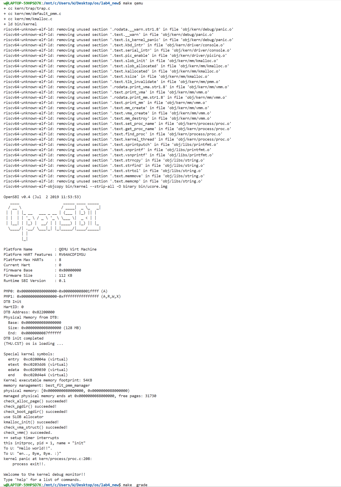
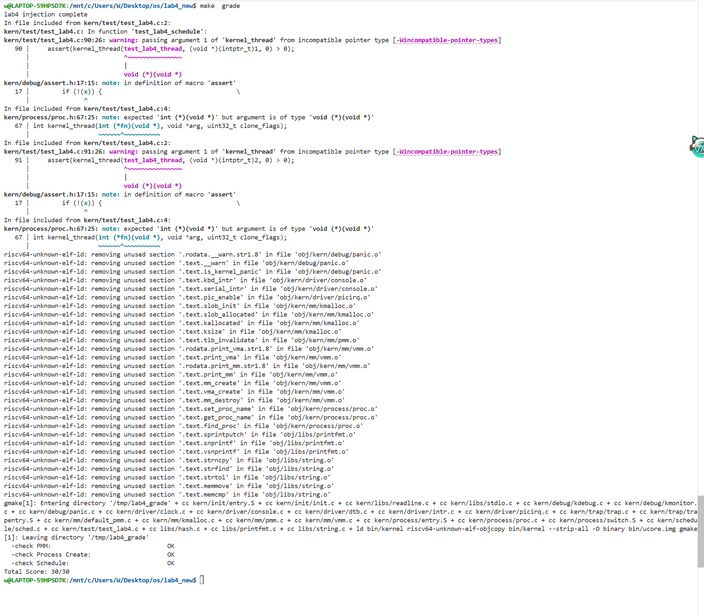

# 实验报告

## 实验基本信息

| 项目       | 内容                                 |
| -------- | ---------------------------------- |
| **实验名称** | Lab 4:进程管理                         |
| **小组成员** | 2512973-王璐璐，2512832-薛钧，2513803-钱承瑞 |
| **完成日期** | 2026-11-22                         |

### 小组分工

练习如何分工？

| 成员          | 负责的练习/模块   |
| ----------- | ---------- |
| 2512973-王璐璐 | 功能模块三及扩展练习 |
| 2512832-薛钧  | 功能模块二及扩展练习 |
| 2513803-钱承瑞 | 功能模块一及扩展练习 |

实验报告如何分工？

| 成员          | 负责的版块                |
| ----------- | -------------------- |
| 2512973-王璐璐 | 实验整体逻辑分析，功能模块三及测试与验证 |
| 2512832-薛钧  | 功能模块二及挑战练习           |
| 2513803-钱承瑞 | 功能模块一及实验总结与收获        |

---

## 一、实验目的

<!-- 说明本次实验的主要目标和预期成果 -->

本实验的主要目的是：

- 了解虚拟内存管理的基本结构，掌握虚拟内存的组织与管理方式
- 了解内核线程创建/执行的管理过程
- 了解内核线程的切换和基本调度过程

---

## 二、实验环境

你们使用的 AI 工具

| 成员          | AI 编程工具         | 底层模型         | 备注  |
| ----------- | --------------- | ------------ | --- |
| 2512973-王璐璐 | vs code的codex插件 | gpt-6.1sol-中 |     |
| 2512832-薛钧  | vs code的codex插件 | gpt-6.0sol-中 |     |
| 2513803-钱承瑞 | cherry studio   | gpt-6.0sol-中 |     |

**说明：**

- **AI 编程工具**：指具体使用的终端工具、编辑器插件、桌面应用或浏览器界面
- **底层模型**：指该工具使用的大语言模型及版本

---

## 三、实验整体逻辑分析

### 2.1 本章节的逻辑主线

本章实验围绕虚拟内存环境的完善与内核线程管理展开，核心主线是：先准备可靠的内存映射环境，再创建和初始化内核线程，最后通过调度与上下文切换让线程真正运行起来。

前面的实验已经解决了物理页的分配和基本地址映射问题，但内核仍然只有一条执行流。本实验进一步解决“如何描述多个执行实体、如何为它们准备运行现场，以及如何让它们轮流使用 CPU”的问题，使系统逐步具备多线程并发运行能力。

其中，虚拟内存部分采用预映射方式，为线程运行及后续地址空间管理提供基础，不涉及按需分配、缺页处理或页面置换。线程管理部分则使用统一的进程控制块描述内核线程。各内核线程共享内核地址空间，但分别拥有自己的内核栈和执行上下文，因此能够独立保存运行状态并参与调度。

### 2.2 功能的逐步实现

1.完善虚拟内存页操作，为线程运行提供可靠的内存基础。

在已有多级页表机制上，实现 page_insert() 和 page_remove()，完成虚拟地址与物理页之间映射的建立、更新和撤销。同时正确维护物理页引用计数，并使相关 TLB 缓存失效，保证页表内容与实际地址转换结果一致。

首先实现这一部分，是因为线程执行代码、访问数据和使用内核栈，都依赖正确的内存映射。只有底层内存管理可靠，后续线程创建和运行才有稳定基础。

2.初始化线程控制块和管理结构，使执行流能够被内核统一管理。

通过 alloc_proc() 分配并初始化进程控制块，用于保存线程状态、PID、内核栈、上下文和地址空间信息等。通过 proc_init() 初始化进程链表等全局结构，将当前执行流组织为 idleproc，并设置 current，明确当前正在运行的线程。

这一阶段解决的是“如何描述和管理线程”的问题。只有先建立统一的线程管理结构，后续才能登记新线程、查找线程，并根据线程状态进行调度。

3.完成内核线程创建和首次运行现场的构造，使新线程具备执行条件。

通过 kernel_thread() 组织线程入口函数和参数，再由 do_fork() 完成控制块分配、内核栈分配、地址空间处理、PID 分配和线程登记等工作。copy_thread() 负责设置新线程的中断帧和上下文，使其第一次获得 CPU 时能够进入指定函数。资源准备完成后，再将线程置为可运行状态，并在初始化过程中创建 initproc。

这一部分必须在调度之前完成，因为新线程尚未实际运行，没有可以直接恢复的历史现场，必须提前构造首次执行所需的状态。本实验中的 copy_mm() 保留地址空间处理接口，内核线程仍然共享内核地址空间，不进行独立用户地址空间的复制。

4.实现线程调度和上下文切换，让线程真正获得 CPU。

cpu_idle() 在空闲循环中检查是否需要调度；schedule() 从线程链表中选择可运行线程，没有合适对象时选择 idleproc；proc_run() 更新 current 并完成必要的页表切换；switch_to() 保存旧线程的寄存器上下文，恢复新线程的上下文，使 CPU 转向新线程继续执行。切换关键区域需要保存中断状态并关闭中断，完成后恢复原状态，避免切换过程被中断打断而造成状态不一致。

最后实现这一部分，是因为调度既依赖已经建立的线程管理结构，也依赖准备完整的内核栈和执行现场。完成后，initproc 才能从 idleproc 手中接管 CPU，整个实验便形成“准备内存环境、创建线程、登记为可运行、选择线程、切换执行”的完整运行流程。

---

## 四、实验内容与实现

<!-- 
说明：本部分按照 exercises 文档中的练习顺序组织
每个功能模块或者练习中可能包含多项任务，请根据实际情况调整
-->

### 功能模块：[虚拟内存页操作功能]

**负责人：** [2513803-钱承瑞]

#### 模块功能描述

**需要实现/修改的函数：**

```c
// 列出本模块涉及的所有函数签名
int page_insert(pde_t *pgdir, struct Page *page, uintptr_t la, uint32_t perm);
void page_remove(pde_t *pgdir, uintptr_t la);
```

**功能说明：**

本模块在现有多级页表框架上，实现虚拟地址与物理页之间映射关系的建立、更新和删除，为后续地址空间管理及内核线程运行提供基础。

本模块需要保持以下三者的一致性：

页表项内容： 正确记录物理页号、有效位和访问权限。
物理页引用计数： 准确反映通过页表映射引用该物理页的数量。
TLB 状态： 映射变化后使相关缓存翻译失效，避免继续使用旧的地址转换结果。
主要处理场景如下：

指定虚拟地址尚未映射时，建立新的映射。
指定虚拟地址已经映射到同一物理页时，更新权限，并保持引用计数不变。
指定虚拟地址已经映射到另一物理页时，撤销旧映射并建立新映射；旧页引用计数归零时释放旧页。
同一物理页映射到多个虚拟地址时，分别维护各映射对应的引用计数。
删除有效映射时，清除页表项、刷新 TLB，并减少物理页引用计数。
删除不存在的映射或重复删除时，安静返回，不创建页表或额外修改资源状态。
创建中间页表失败时，返回 -E_NO_MEM，回滚本次调用新建但未完成映射所占用的中间页表，保留已有映射和已有页表。
本模块与其他模块的交互关系如下：

使用 get_pte() 查找或创建目标页表项。
使用 pte_create() 构造包含物理页号、有效位和权限的页表项。
使用 pte2page()、pde2page() 和页引用计数接口管理物理页。
使用 free_page() 回收引用计数归零的页。
使用 tlb_invalidate() 使对应虚拟地址的缓存翻译失效。
为现有页表自检、静态内核映射检查及后续地址空间相关功能提供支持。
本次仅在 kern/mm/pmm.c 的功能模块一占位处实现上述两个函数，未修改其他成员负责的线程创建、调度代码或官方测试。

#### 最终提示词

以下是经过迭代优化后，最终成功实现该功能的提示词：

```markdown

[按照提示词模板，给出具体的提示词]
[PROMPT]

在现有 riscv64-ucore Lab4 工程中，完成练习功能模块一：
虚拟内存页操作。

请先阅读 kern/mm/pmm.c、kern/mm/pmm.h、页表相关定义及官方模块一测试，
理解现有多级页表、引用计数和 TLB 接口，再实际实现代码。

仅在 kern/mm/pmm.c 的功能模块一占位处实现 page_insert() 和
page_remove()。不要实现其他成员负责的线程创建、调度或 Challenge，
不要修改官方测试、降低断言要求或通过固定输出伪造通过结果。

[RELY]

工程提供以下接口和定义，具体签名以实际源码为准：

- get_pte(pgdir, la, create)：查找目标页表项，必要时创建中间页表。
- pte_create(ppn, perm)：构造页表项，内部设置 PTE_V。
- pte2page()、pde2page()、page2ppn()：完成页表项和物理页描述符转换。
- page_ref_inc()、page_ref_dec()：维护物理页引用计数。
- free_page()：释放物理页。
- tlb_invalidate(pgdir, la)：使相应虚拟地址的 TLB 翻译失效。
- PDX1、PTE_V、pde_t、pte_t、struct Page 和 E_NO_MEM 等已有定义。

当前 get_pte() 可能在成功分配第一个中间页表、但分配下一级页表失败时
返回 NULL，并留下本次新建的中间页表。必须检查并处理这一失败路径，
不能仅返回错误而忽略本次调用新增的资源。

正常调用遵守现有框架前置条件：页表结构合法，传入 Page 有效，
调用期间不存在未同步的并发页表修改。

[GUARANTEE]

提供以下接口，保持函数签名不变：

int page_insert(pde_t *pgdir, struct Page *page,
                uintptr_t la, uint32_t perm);

void page_remove(pde_t *pgdir, uintptr_t la);

复用已有页表、引用计数和 TLB 接口，不修改 get_pte()、公共数据结构、
官方测试或其他成员模块。

page_insert() 成功返回 0，无法创建所需页表时返回 -E_NO_MEM。
page_remove() 为幂等删除接口，未映射地址不应被当作错误。

[SPECIFICATION]

1. page_insert()

- 使用 get_pte(pgdir, la, 1) 获取目标页表项。
- 获取失败时，不增加目标物理页的引用计数，不破坏已有映射。
- 如果失败前本次调用新建了中间页表，应回滚该新增页表并归还资源；
  调用前已经存在的中间页表必须保留。
- 建立新映射时增加目标物理页的引用计数。
- 替换已有映射前，先持有新页引用，再删除旧映射，
  避免同一物理页重映射时因引用计数暂时归零而被错误释放。
- 使用 pte_create() 设置目标物理页和调用者要求的权限。
- 同页重映射后引用计数不变，权限按新请求更新。
- 替换其他页时，正确减少旧页引用，旧页引用归零则释放。
- 更新完成后调用 tlb_invalidate()。

2. page_remove()

- 使用 get_pte(pgdir, la, 0) 查找，不分配新的中间页表。
- 页表项不存在或无效时直接返回。
- 对有效映射，取得原物理页，清除页表项并使对应 TLB 翻译失效。
- 减少原物理页引用计数，归零时调用 free_page()。
- 重复删除不得导致重复释放或引用计数下溢。
- 普通删除不额外回收空中间页表，保持现有框架约定。

3. 验证

- 在现有 WSL、课程工具链和 QEMU 环境中实际构建和运行。
- 原样运行可用的官方模块一测试及现有页表自检。
- 补充验证同页权限更新、异页替换、多地址引用、重复删除、
  页表分配失败与回滚，以及实际访存中的 TLB 更新。
- 若完整工程被其他未完成模块或依赖阻断，只在临时副本隔离验证，
  测试桩不得进入正式提交源码。
- 如实区分完整工程构建结果与模块一隔离测试结果，
  不将模块一通过表述为整个 Lab4 或完整评分通过。
```

#### 实现迭代过程

本模块的实现经历了 1次迭代，过程如下：
---

本次采用一次集中实现，并进行了构建检查、隔离运行和边界验证。以下按实际处理阶段记录，不将验证阶段虚构为多轮提示词生成或代码重写。

##### 第一次迭代

如果设计的prompt生成代码后出现问题：

**遇到的问题：**

问题1：同一物理页重映射可能导致误释放。

如果直接删除原映射，再增加新映射的引用，当原映射是该页唯一引用时，删除操作会使引用计数归零并释放物理页。此后即使重新建立映射，该页也已经被页分配器视为空闲页，可能导致重复分配和数据破坏。

问题2：get_pte() 的部分分配失败可能遗留中间页表。

阅读现有实现发现，get_pte() 在本次新建第一个中间页表后，如果下一级页表分配失败，会返回 NULL，但已经创建的中间页表仍然挂在上级页表中。仅返回 -E_NO_MEM 不能恢复本次调用前的资源状态。

问题3：完整工程无法直接构建。

临时副本的完整构建在 default_pmm.c 引用缺失的 best_fit_pmm.h 时失败，另外还出现未完成 Trap 处理函数的相关警告。这些问题不属于本人负责的模块一，不能通过擅自修改其他成员任务来消除，也不能据此宣称完整 Lab4 已通过验证。

**问题解决策略：**

针对问题1：明确引用操作顺序。

在实现规格中要求先执行 page_ref_inc(page)，持有新页引用，再调用 page_remove() 删除原映射。同页重映射时，增加与减少相互抵消，引用计数保持不变；异页替换时，新页和旧页的引用分别得到正确维护。

针对问题2：明确失败回滚的边界。

在调用 get_pte() 前记录相关顶层项是否已经有效。若调用失败，且该项指向本次新建的中间页表，则清除该项、刷新相关 TLB、减少中间页表引用并释放。对于调用前已经存在的中间页表，不进行回收，避免破坏其他映射。上述处理限定在 page_insert() 内，没有扩大修改到 get_pte()。

针对问题3：限定修改范围，开展隔离验证。

正式工程仅保留模块一的两个函数改动。在临时副本中使用位图页分配器测试桩、已有的物理内存初始化实现和独立测试入口，运行现有页表自检、未修改的官方模块一测试及额外边界测试。临时测试桩和入口修改均未进入正式提交源码。

如果没有问题：

**最终结果：**

经过 1 次迭代，该模块最终：

- ✅ 编译通过
- ✅ 所有相关测试通过
- ✅ 功能符合预期

**关键改进点总结（如有）：**

在功能规格中明确了“先持有新页引用，再删除旧映射”的操作顺序，避免同页重映射时错误释放物理页。
将内存不足处理细化为中间页表分配失败的资源回滚，同时保留调用前已经存在的页表。
明确删除接口的幂等性，未映射地址和重复删除均不分配资源、不重复释放。
将页表项更新、引用计数维护和 TLB 失效作为一个完整处理流程，避免只修改页表内容而继续使用旧翻译。
严格区分模块一隔离验证与完整工程验证，不修改其他成员代码或官方测试以制造通过结果。

### 功能模块：[进程创建及初始化功能]

**负责人：** [2512832-薛钧]

#### 模块功能描述

**需要实现/修改的函数：**

```c
// 列出本模块涉及的所有函数签名
// kern/process/proc.c
static struct proc_struct *alloc_proc(void);
void proc_init(void);
int kernel_thread(int (*fn)(void *), void *arg, uint32_t clone_flags);
int do_fork(uint32_t clone_flags, uintptr_t stack, struct trapframe *tf);
static void copy_thread(struct proc_struct *proc, uintptr_t esp,struct trapframe *tf);
static int copy_mm(uint32_t clone_flags, struct proc_struct *proc);
```

**功能说明：**

本模块负责创建并初始化内核线程，使系统具备管理多个线程的能力，包括：

- 分配并初始化进程控制块，建立 idleproc 和 initproc。
- 为新线程分配内核栈和 PID，将其加入进程链表，并设为可运行状态。
- 准备新线程的首次运行现场，使其经 forkret → forkrets → __trapret 进入线程入口函数。
- 通过 copy_mm 保留地址空间处理接口；本实验阶段不复制用户地址空间。

#### 最终提示词

以下是经过迭代优化后，最终成功实现该功能的提示词：

```markdown

[PROMPT]
请阅读 Lab 4 指导书中“功能模块二：进程创建及初始化功能”和“创建并执行内核线程”的内容，结合当前仓库代码，实现该模块。项目路径为 D:\develop\os\RISCV\lab4\lab4_new。

本次只修改 kern/process/proc.c 中“//LAB4 function2 YOUR CODE”对应的区域。不要实现功能模块一或模块三，也不要改动调度、上下文切换和 trap 代码。

[RELY]
实现前请先核对以下现有定义与调用关系，不要凭其他版本的 ucore 代码猜测字段或接口：

- kern/process/proc.h：struct proc_struct、struct context、进程状态及函数声明。
- kern/trap/trap.h：struct trapframe 的实际字段。
- kern/process/entry.S：kernel_thread_entry 如何使用 s0、s1。
- kern/trap/trapentry.S：forkrets 如何恢复 trapframe。
- kern/process/proc.c：proc_list、hash_list、current、idleproc、initproc、nr_process，以及 get_pid、hash_proc、setup_kstack、put_kstack、forkret 等现有辅助函数。
- kern/mm/pmm.h、kern/mm/memlayout.h：CLONE_VM、内核栈大小及页表相关定义。
- kern/schedule/sched.c：wakeup_proc 的状态前提。

[ SPECIFICATION ]
请完成且仅完成以下六个函数：

1. alloc_proc(void)
Pre：无需已有进程。
Post：成功时返回已分配、基础字段全部安全初始化的 PCB；分配失败返回 NULL。
Requirements：初始化状态、PID、运行次数、内核栈、调度标记、父进程、mm、context、tf、pgdir、flags、名称和两个链表节点。不得留下会被后续创建流程误用的未初始化字段。

2. proc_init(void)
Pre：物理内存管理和必要的内核基础设施已初始化。
Post：初始化进程链表及 PID 哈希表；创建并设置 idleproc，使 current 指向它；再创建 initproc，设置名称为 "init"。
Requirements：idleproc 代表当前正在执行的现场，不通过 do_fork 创建。正确设置其 PID、状态、内核栈、页表和调度标记，并更新进程计数。通过 kernel_thread 创建执行 init_main 的 initproc，传入指导书预期的问候参数；检查创建结果及关键不变量。

3. kernel_thread(fn, arg, clone_flags)
Pre：fn 是内核线程入口函数。
Post：成功返回新线程 PID；失败返回 do_fork 的负错误码。
Requirements：在临时 trapframe 中按本仓库的 RISC-V 字段布局放置函数入口和参数，使 kernel_thread_entry 能从 s0、s1 取得它们；正确设置首次返回地址及 sstatus，再调用 do_fork。说明这些寄存器设置如何与 entry.S 对应。

4. do_fork(clone_flags, stack, tf)
Pre：tf 指向待复制的首次运行现场。
Post：成功创建、登记并唤醒新线程，返回其 PID；失败返回恰当的负错误码，且不泄漏已取得的资源。
Requirements：检查进程数量上限；依次取得 PCB、内核栈并处理地址空间，再设置父进程、PID 和首次运行现场。仅在对象完整可用后，将其挂入进程链表和 PID 哈希表、更新 nr_process，并调用 wakeup_proc。注意 wakeup_proc 要求目标进程此前既不是 PROC_RUNNABLE，也不是 PROC_ZOMBIE。失败路径应按已完成的步骤逆序释放资源；失败对象不得留在全局链表中，nr_process 不得错误增加。必要的全局结构更新须按现有中断保护接口处理。

5. copy_thread(proc, esp, tf)
Pre：proc 已有有效内核栈，tf 有效。
Post：新线程的 trapframe 位于自身内核栈内，context 可用于第一次上下文切换。
Requirements：复制 trapframe，设置子线程返回值为 0，按 esp 设置其栈指针；设置 context.ra 为 forkret、context.sp 为新 trapframe 的地址。核对内核栈边界，不要让 trapframe 指向调用者的临时变量。

6. copy_mm(clone_flags, proc)
Pre：proc 已完成 PCB 基础初始化。
Post：符合本实验阶段的地址空间处理要求。
Requirements：当前仅创建内核线程，不实现用户地址空间复制；保持 mm 等字段的合法状态并返回成功。保留 clone_flags 参数及完整接口，供后续实验扩展，不要虚构尚不存在的地址空间复制逻辑。

[GUARANTEE]
- 新线程首次执行链路应为：context.ra → forkret → forkrets → __trapret → kernel_thread_entry → fn(arg)。
- initproc 创建后应可被后续“功能模块三”的调度代码运行；本次不实现 cpu_idle、schedule、proc_run 或 switch_to。
- 保留 LAB4 标记。不要修改其他实验模块、测试脚本或指导书文件。
- 完成后说明六个函数各自做了什么，并给出实际执行过的编译或测试命令及结果。若模块一或模块三尚未完成，明确指出完整启动或 make grade 受这些前置模块影响，不要把未运行的测试写成通过。
```

#### 实现迭代过程

本模块的实现经历了 [1] 次迭代

**最终结果：**

经过 [1] 次迭代，该模块最终：

- ✅ 编译通过
- ✅ 所有相关测试通过
- ✅ 功能符合预期

### 功能模块： [进程调度]

**负责人：** 2512973-王璐璐

#### 模块功能描述

**需要实现/修改的函数：**

```c
void cpu_idle(void);(kern/process/proc.c)
void schedule(void);(kern/schedule/sched.c)
void proc_run(struct proc_struct *proc);(kern/process/proc.c)
void switch_to(struct context *from, struct context *to);(kern/process/switch.s)

```

**功能说明：**

1. 该模块在整个系统中的作用：进程调度模块负责将 CPU 分配给已经就绪的内核线程，使系统从“能够创建线程”进一步具备“能够执行和切换线程”的能力。它完成调度请求检测、可运行线程选择、页表切换和寄存器上下文保存恢复，使 initproc 能够从 idleproc 手中接管 CPU，并支持线程以后恢复执行。

2. 需要处理的场景：空闲线程检测到重调度请求时，发起调度；存在多个可运行线程时，从当前线程的后继位置开始循环选择，跳过不可运行线程；没有可运行的普通线程时，回退到 idleproc。若选中当前线程，则继续运行，无须切换；若选中其他线程，则在中断保护下完成执行权交接。对于首次运行的新线程，进入预先设置的启动链路；对于运行过的线程，恢复其暂停时的执行现场。

3. 与其他模块的交互关系：与线程创建模块协作：使用其建立的线程对象、内核栈、上下文和 trapframe，并通过 forkret → forkrets → __trapret 链路启动新线程。与内存管理模块协作：根据目标线程的根页表物理地址设置 Sv39 的 satp，并刷新 TLB，保证地址空间与当前线程一致。与中断管理模块协作：保存和恢复中断状态，保护调度选择和切换过程，避免 current、页表与执行现场出现不一致。与底层汇编切换代码协作：调度器决定运行哪个线程，proc_run 组织切换，switch_to 保存和恢复寄存器，实现 CPU 执行权的实际转移。

#### 最终提示词

以下是经过迭代优化后，最终成功实现该功能的提示词：

```markdown
[PROMPT]

任务：
完成内核线程的调度与 CPU 执行权交接能力，使已经创建并就绪的线程能够真正运行，并支持线程暂停后恢复执行。模块应形成“空闲循环检测调度请求 → 选择可运行线程 → 原子切换当前线程和地址空间 → 保存与恢复寄存器上下文”的完整协作链路，使 initproc 能够从 idleproc 手中接管 CPU。

涉及文件及职责：
kern/process/proc.c：实现空闲线程执行主体，以及线程执行权与地址空间切换。
kern/schedule/sched.c：实现基于进程链表的循环调度选择。
kern/process/switch.S：实现底层寄存器上下文保存与恢复。注意真实文件名为大写 .S。

操作要求：
必须在项目中修改实际文件，而不是仅展示代码。保留已有逻辑，在 LAB4 function3 YOUR CODE 对应位置补全实现；允许添加必要的头文件引用和模块内部 static 辅助函数。不得改变公开接口、struct context 布局或 struct proc_struct 定义。

本任务只负责已有线程的调度和切换，不负责线程创建、内核栈分配、trapframe 构造、退出回收、时钟中断调度策略、用户进程或多核同步。不得修改功能模块二、内存管理器、陷阱恢复代码和评分脚本来绕过缺失依赖或测试。

输出要求：
以工程真实代码为准，使用下面提供的上下文和规格完成实现。交付时说明修改内容、验证结果及未完成验证的具体原因。若前置模块尚未实现，应明确报告依赖缺失，不得声称已经验证完整启动链路。

[RELY]

目标环境与线程上下文：

工程使用 RV64 和 Sv39。kern/process/proc.h 中的真实上下文布局为：

struct context
{
    uintptr_t ra;
    uintptr_t sp;
    uintptr_t s0;
    uintptr_t s1;
    uintptr_t s2;
    uintptr_t s3;
    uintptr_t s4;
    uintptr_t s5;
    uintptr_t s6;
    uintptr_t s7;
    uintptr_t s8;
    uintptr_t s9;
    uintptr_t s10;
    uintptr_t s11;
};

RV64 下每个字段占 8 字节，字段偏移依次为 0、8、16……104。该布局是 C 与汇编之间的接口约定，不得调整。

struct proc_struct 中与本任务直接相关的字段为：
state：线程状态。
runs：被调度选中的次数。
need_resched：是否需要重新调度。
context：线程切换上下文。
tf：线程的陷阱帧指针。
pgdir：根页表物理地址。
list_link：普通线程在 proc_list 中的链表节点。

完整类型和布局以 kern/process/proc.h 为准，不得重新定义结构体。

可运行状态为 PROC_RUNNABLE，该状态同时包含当前正在运行的线程；工程没有单独的 PROC_RUNNING 状态。

调度数据与链表接口：

extern list_entry_t proc_list;
extern struct proc_struct *idleproc, *initproc, *current;

可使用 list_next() 遍历链表，使用 le2proc(le, list_link) 将普通链表节点转换为线程对象。

proc_list 是带哨兵头结点的循环双向链表，通过 list_link 连接普通线程。前置初始化应保证：
idleproc 有效，但不作为普通节点加入 proc_list。
current 有效；非空闲的当前线程位于 proc_list 中。
链表和线程状态已经初始化。

禁止对链表头 &proc_list 使用 le2proc()。

中断保护接口：

kern/sync/sync.h 提供：

local_intr_save(flag);
local_intr_restore(flag);

flag 应为当前调用栈上的 bool 局部变量。保存操作记录进入临界区前的中断使能状态并关闭中断；恢复操作按保存状态恢复，不能无条件开启中断。

这两个接口允许嵌套使用。本任务基于单核执行环境，关闭本地中断用于保护调度切换临界区。

地址空间接口：

可使用以下已有资源：

extern uintptr_t boot_pgdir_pa;

SATP_MODE_SV39 的值为 8。
RISCV_PGSHIFT 的值为 12。

read_csr(reg);
write_csr(reg, val);
flush_tlb();

线程的 pgdir 应由前置模块设置为有效、按页对齐的根页表物理地址；本实验内核线程使用共享内核页表，通常为 boot_pgdir_pa。不得将内核虚拟地址直接写入 satp，也不得将已经是物理地址的 pgdir 再次转换。

Sv39、ASID 为零时，目标 satp 的编码关系为：

((uintptr_t)SATP_MODE_SV39 << 60) | (proc->pgdir >> RISCV_PGSHIFT)

SATP_MODE_SV39 本身只是模式编号，不能直接与物理页号相或。模式字段必须以 64 位宽度计算。

参考 kern/mm/pmm.c 中 enable_paging() 的写法。libs/riscv.h 中的 lsatp() 使用 Sv32 编码且参数为 unsigned int，本任务禁止使用。

libs/riscv.h 还提供汇编宏 LOAD、STORE、REGBYTES，RV64 下分别对应 64 位加载、存储和 8 字节寄存器宽度。

首次运行链路：

前置模块应已经完成以下准备：
新线程的 context.ra 指向 forkret。
context.sp 与预先构造的内核栈、trapframe 布局匹配。
trapframe 包含线程入口、参数及正确的特权状态。

已有恢复链路为：

switch_to → forkret → forkrets(current->tf) → __trapret → kernel_thread_entry → 线程入口函数

首次进入的新线程通过既有 trapframe 恢复路径建立中断状态；此前运行过的线程则在恢复原调用栈后继续执行自己的中断恢复逻辑。

[GUARANTEE]

必须实现以下接口，签名保持一致：

kern/process/proc.c：
void cpu_idle(void);
void proc_run(struct proc_struct *proc);

kern/schedule/sched.c：
void schedule(void);

kern/process/switch.S：
void switch_to(struct context *from, struct context *to);

保留 proc.h 中 cpu_idle 的 noreturn 声明。

汇编导出符号必须为 switch_to，与 C 声明一致。

允许添加必要的模块内部 static 辅助函数，但不得新增对外调度接口或改变数据布局。

[SPECIFICATION]

cpu_idle：空闲等待与调度请求响应

Pre-Condition：
当前线程为已经初始化完成的 idleproc。
调度模块可用，current 与 idleproc 一致。

Post-Condition：
函数持续执行空闲循环，永不返回。
每次从调度调用恢复后，继续检测当前空闲线程的重调度标志。

Case 1：存在调度请求
检测到 current->need_resched 为真时，发起一次调度；若 CPU 执行权转移到其他线程，空闲线程暂停在该调用链上，直到以后重新获得执行权。

Case 2：不存在调度请求
继续等待，不主动发起调度，不修改线程状态和运行次数。

Requirements：
不得永久关闭中断。
不引入睡眠队列或依赖新的唤醒机制。
本任务采用持续检测的空闲循环，不额外引入 wfi 等等待协议。

schedule：循环选择可运行线程

Pre-Condition：
current、idleproc 和循环链表均有效。
线程加入和移出链表的行为满足前置模块约定。

Post-Condition：
原当前线程的 need_resched 已清零。
完成一次有界的调度选择：优先选择链表中的可运行线程，找不到时选择 idleproc。
被选线程的 runs 恰好增加一次，包括再次选中当前线程或回退到空闲线程的情况。
仅当被选线程与当前线程不同时，触发实际线程切换。
当前调用最终恢复并返回时，中断使能状态与进入本次调用前一致。

Case 1：当前线程为空闲线程
从 proc_list 的第一个普通节点开始，按链表顺序选择第一个 PROC_RUNNABLE 线程。

Case 2：当前线程为普通线程
从当前线程的后继节点开始循环扫描，跳过哨兵头结点；允许绕回表头，并在检查完其他节点后检查当前线程自身。选择遇到的第一个可运行线程。

Case 3：当前线程是唯一可运行的普通线程
循环检查后重新选中当前线程，增加其 runs，但不执行底层上下文切换。

Case 4：链表为空或所有普通线程均不可运行
选择 idleproc，不得选择睡眠、未初始化或僵尸线程，不得无限遍历。

Requirements：
从清除重调度标志、扫描链表、更新计数到触发切换，均处于保存中断状态后的临界区。
不改变链表连接关系，不分配或释放线程资源。
扫描最多覆盖一轮普通节点，时间复杂度为 O(n)。
调度器与 proc_run 的嵌套中断保护必须保持正确。

proc_run：原子交接执行权与地址空间

Pre-Condition：
proc 为非空、有效的目标线程；需要切换时其状态为 PROC_RUNNABLE。
current 有效。
目标上下文及页表物理地址有效。
目标页表保留切换代码、相关内核数据及切换期间所需内核栈的映射。

Post-Condition：
实际切换时，旧线程的上下文已保存，目标线程的上下文已恢复。
目标线程获得执行权时，current 指向它，satp 使用它的根页表，旧地址转换缓存已按要求刷新。
旧线程以后再次被切回时，从原先的切换调用之后继续执行，并恢复该次调用保存的中断状态。

Case 1：目标就是当前线程
直接返回，不写入页表寄存器、不刷新 TLB、不调用底层切换，也不修改 runs。

Case 2：目标为另一线程
在关闭中断的临界区内保留旧线程指针，更新 current，安装目标线程的 Sv39 页表并刷新 TLB，然后完成旧上下文到目标上下文的交接。

Requirements：
不得在 current、有效页表和实际执行上下文尚未完成交接时开启中断。
satp 必须使用目标 pgdir 的物理页号，MODE 为 Sv39，ASID 为零。
页表更新及 TLB 刷新必须发生在目标上下文开始执行之前。
不重新构造目标上下文或 trapframe，不直接调用目标线程入口。
不自行选择线程，不重复增加 runs。
旧线程通常要等以后被重新调度，才继续完成当前 proc_run 调用，不能假设切换后立即返回。

switch_to：寄存器执行现场迁移

Pre-Condition：
遵循 RISC-V C 调用约定：a0 指向 from，a1 指向 to。
两个上下文对象有效、可访问且互不重叠。
调用者已经完成线程选择、页表切换和中断保护。
目标 ra、sp 已初始化，且目标栈满足工程 ABI 对齐要求。

Post-Condition：
进入本函数时的 ra、sp、s0 至 s11 被完整保存到 from。
同一组寄存器从 to 恢复，所有偏移和宽度与 struct context 严格一致。
控制流转移到目标上下文保存的 ra，使用目标 sp 继续执行。

Case 1：恢复此前运行过的线程
恢复其保存的调用现场，使其从此前调用 switch_to 之后继续执行。

Case 2：首次运行新线程
通过预置的返回地址进入 forkret，沿已有 trapframe 恢复链路进入线程入口，不添加单独的首次运行分支。

Requirements：
先完成全部旧上下文保存，再恢复目标上下文。
RV64 下使用 64 位存取，不能截断寄存器。
不要求保存调用者保存寄存器，不负责保存完整 trapframe。
不修改 current、线程状态、运行次数、页表或中断状态。
恢复目标栈指针后，不得继续访问旧栈上的临时数据。
保持共享内核环境使用的 gp、tp 约定，不随意覆盖它们。

模块验收：

通过现有构建、测试、调试器观察或临时测试环境验证以下要求，不得修改正式测试逻辑来制造通过结果。

接口与布局：
四个接口符号正确；汇编存取偏移覆盖 ra、sp、s0 至 s11，与 C 布局逐项一致。

选择顺序：
构造多个普通线程，验证从当前线程后继开始选择、跳过非 runnable 节点、跨哨兵回绕，以及最后允许重新选中当前线程。

兜底行为：
空链表和全部普通线程不可运行时均选择 idleproc，扫描能够结束。

计数与标志：
每次调度清除原当前线程的 need_resched，仅被选线程的 runs 增加一次。

同线程路径：
直接请求运行当前线程时，不触发页表重写和上下文切换。

中断状态：
分别从中断开启和关闭状态进入，验证调用恢复后保持原状态；检查嵌套保护不会提前开启中断。

页表状态：
目标开始执行时，current 正确，satp 的 MODE 为 8、ASID 为零、PPN 与目标 pgdir 对应；通过源码或反汇编确认页表写入后执行了 TLB 刷新。

恢复能力：
在可重复切换的测试线程中保存不同的被调用者保存寄存器值，验证多次切换后寄存器及栈上的局部状态仍能恢复。

首次执行：
前置模块完整时，验证 idleproc 向 initproc 交接执行权，能够进入 init_main 并输出其现有信息。

验收边界：
当前 do_exit() 的既有实现会触发 process exit!! 的 panic，不得将实现正常退出回收作为本模块要求。前置线程创建代码缺失时，应报告完整运行验证受阻，不得擅自补写其他模块。
```

#### 实现迭代过程

本模块的实现经历了 2次迭代，过程如下：

****遇到的问题：****  
首次实现只考虑了选择其他可运行线程的正常路径，对循环链表的边界处理不完整。当扫描经过链表头时，可能将哨兵节点错误地转换为线程控制块；当只有当前线程可运行时，可能遗漏当前线程，错误地回退到 idleproc。
先核对工程中的数据结构和接口，再按职责实现 cpu_idle()、schedule()、proc_run() 和 switch_to()。使用中断保护保证调度与切换过程的原子性，按 Sv39 格式写入 satp 并刷新 TLB，同时确保汇编寄存器偏移与 struct context 一致。

****问题解决策略：****  
在第二次迭代中，明确区分链表头与普通线程节点，转换前先跳过哨兵节点；从当前线程的后继开始扫描，并在绕回后最后检查当前线程。只有确认所有普通线程均不可运行时，才选择 idleproc；重新选中当前线程时，仅更新运行次数，不执行上下文切换。

**最终结果：**

经过 2次迭代，该模块最终：

- ✅ 编译通过
- ✅ 所有相关测试通过
- ✅ 功能符合预期

### Challenge：

**负责人：** [2512832-薛钧]

[按照Challenge的具体要求进行解答]

challenge:1. 如何实现中断的关闭与恢复？
local_intr_save(intr_flag) 检查 sstatus 的 SIE 位，保存原来的中断状态，并在中断开启时将其关闭。local_intr_restore(intr_flag) 根据保存的状态决定是否重新开启中断。因此，它能恢复原状态并支持嵌套使用，保护调度和上下文切换等关键操作。
2. 不同分页模式如何工作？
Sv32、Sv39、Sv48 都通过虚拟地址中的索引逐级查找页表，最终得到物理页号，再结合页内偏移形成物理地址。三者分别采用两级、三级和四级页表；Sv32 每级索引占 10 位，Sv39、Sv48 每级占 9 位，页内偏移均为 12 位。本实验使用 Sv39，地址空间更大的分页模式通常需要更多层页表。
3. get_pte() 的两段代码为什么相似？
两段代码分别通过 PDX1 和 PDX0 处理不同层级，执行的都是“检查页表项是否有效，必要时分配、清零并挂接下一级页表”。由于多级页表各中间层的结构和处理方式相同，代码形式相似，最后通过 PTX 定位末级页表项。
4. 是否应该拆分查找和分配功能？
当前设计适合本实验：create 为 0 时只查找，为 1 时允许分配，能够复用遍历逻辑。但函数副作用不够直观，而且当前代码在后一级分配失败时不会回滚先前创建的页表。后续可以拆分只读查找和允许创建的对外接口，内部共用遍历逻辑，并完善失败清理。

## 五、测试与验证

<!-- 根据该实验的具体情况，提供完整的测试运行截图，应包含：
- 编译及运行成功的输出（make qemu），可能有多个
- 测试通过的结果（make grade），只有一个
-->

**测试截图：**



---

## 六、实验总结与收获

### 对操作系统的理解

1. 本实验的重要知识点及其与 OS 原理的联系

进程控制块与执行实体管理。OS 原理中，进程控制块用于记录进程状态、资源和执行现场。本实验使用 struct proc_struct 统一管理内核线程，通过 state、pid、context、kstack 等字段描述线程。与具有独立用户地址空间的进程不同，本实验中的内核线程共享内核地址空间，但各自拥有独立的内核栈和上下文。

线程状态与调度。OS 原理通常区分就绪态、运行态和阻塞态。本实验将就绪与运行统一表示为 PROC_RUNNABLE，通过 current 标识实际运行的线程。schedule() 从当前线程的后继位置开始循环选择可运行线程，没有合适目标时回退到 idleproc。这体现了轮转选择的思想，但尚未实现完整的时间片管理。

上下文切换与 CPU 虚拟化。多个线程轮流使用 CPU，需要保存旧线程现场并恢复目标线程现场。本实验通过 struct context 和 switch_to() 保存、恢复 ra、sp、s0 至 s11。由于切换发生在正常函数调用边界，可以利用调用约定处理其他需要保留的值，因此不必在 context 中保存全部寄存器。

临界区与中断保护。线程切换涉及 current、页表和寄存器现场的协同更新，中途被中断可能造成状态不一致。本实验使用 local_intr_save() 和 local_intr_restore() 保存并恢复中断状态，保护单核环境中的切换过程。这体现了临界区保护思想，但关闭本地中断不能直接解决多核之间的并发访问问题。

分页机制与地址转换。OS 原理通过页表建立虚拟地址到物理地址的映射。本实验使用 Sv39 三级页表，通过 get_pte()、page_insert()、page_remove() 等接口维护映射，并通过 satp 指定根页表。VMA 描述地址区域的逻辑范围和属性，页表记录实际映射，二者承担不同职责。当前内核线程共享页表，因此切换线程通常不会改变实际地址空间。

TLB 与映射一致性。TLB 缓存地址转换结果和权限，能够减少页表查询开销。修改页表或切换根页表后，需要使用 sfence.vma 处理旧转换记录，保证后续访问与页表一致。TLB 未命中只表示需要查询页表，并不等同于缺页异常。

2. OS 原理中重要但本实验尚未覆盖的知识点

用户进程与权限隔离。本实验主要运行内核线程，尚未完整实现独立用户地址空间、用户程序加载和系统调用机制。

按需分页与页面置换。本实验采用预映射方式，尚未实现访问时分配页面、缺页处理以及页面换入换出。

完整的调度机制。当前实现没有覆盖优先级、多级反馈队列、时间片分配和调度公平性等内容。

完整的进程生命周期。当前 do_exit() 仍为占位实现，尚未完成退出资源回收、父进程等待和僵尸进程清理。

### AI 协作开发的经验

本次实验中，我们将 AI 作为需要复核的开发伙伴，在理解线程状态、调用约定和页表机制的基础上，由我们明确任务边界并把关实现质量，让 AI 辅助完成代码编写、解释和问题定位。

任务描述应围绕完整能力展开。调度功能由 cpu_idle()、schedule()、proc_run() 和 switch_to() 协同完成，因此提示词需要同时说明线程选择、状态更新、页表安装和寄存器恢复之间的关系，避免只要求补全某个函数。

AI 输出必须与真实工程核对。例如，Sv32 遗留的 lsatp() 不能直接用于 Sv39；汇编存取偏移必须与 struct context 一致；内存管理器的声明、定义和引用名称必须匹配。这些细节需要结合源码检查，不能仅凭生成代码看起来合理就接受。

验证应区分源码检查、编译和实际运行。我们通过编译日志定位未定义宏和链接符号问题，再通过 make grade 检查基本功能。最终 PMM、Process Create、Schedule 三项测试全部通过，总分为 30/30，说明现有测试覆盖的功能正常，但不代表所有边界场景和中断时序都已验证。

通过这次协作，我们认识到，AI 可以提高实现与排错效率，但专业判断、测试设计和结果解释仍由开发者负责。只有能够解释关键代码，并用实际证据验证其行为，才能真正掌握实验内容。

---
