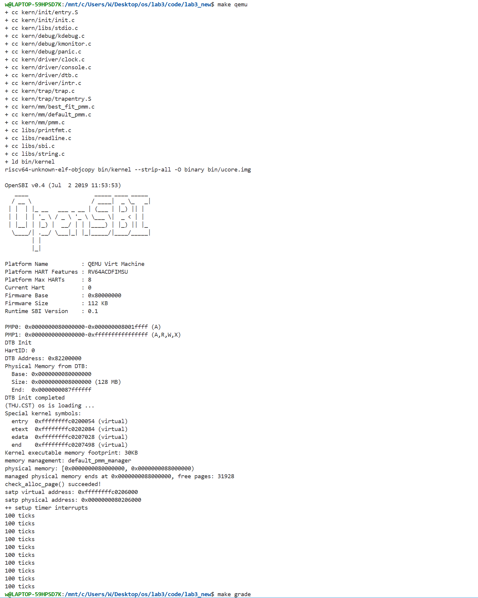
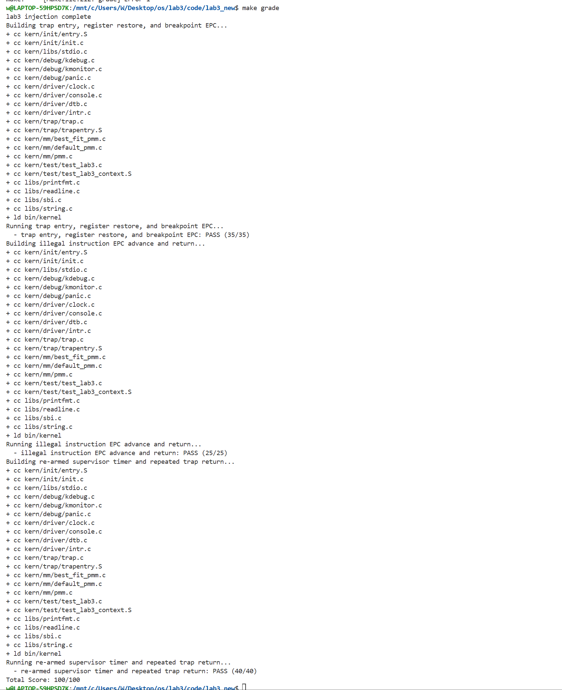

# 实验报告

## 实验基本信息

| 项目       | 内容                                 |
| -------- | ---------------------------------- |
| **实验名称** | Lab 3:断,都可以断                       |
| **小组成员** | 2512973-王璐璐，2512832-薛钧，2513803-钱承瑞 |
| **完成日期** | 2026-11-8                          |

### 小组分工

练习如何分工？

| 成员          | 负责的练习/模块    |
| ----------- | ----------- |
| 王璐璐-2512973 | 功能模块一及功能模块二 |
| 2512832-薛钧  | 功能模块一及功能模块二 |
| 2513803-钱承瑞 | 功能模块一及功能模块二 |

实验报告如何分工？

| 成员          | 负责的练习/模块      |
| ----------- | ------------- |
| 2512973-王璐璐 | 功能模块一及测试与验证   |
| 2512832-薛钧  | 功能模块二及实验收获与总结 |
| 2513803-钱承瑞 | 实验目的及实验整体逻辑分析 |

---

## 一、实验目的

本实验在 Lab2 物理内存管理的基础上，学习 RISC-V 架构的中断与异常机制，建立从 Trap 发生、上下文保存、处理函数调用到上下文恢复和返回的完整执行流程，使内核不仅能够响应事件，还能够在处理后正确恢复原来的执行状态。

具体目标如下：

### 1.理解中断与异常的基本概念 区分时钟等异步中断与断点、非法指令等同步异常，理解它们的触发方式和返回行为。 掌握 Trap 相关寄存器及特权级机制。

### 2.理解 stvec、sepc、scause、stval 和 sstatus 的作用，明确 Trap 发生时硬件与软件各自承担的工作，以及 S 态 Trap 进入和返回过程中的状态变化。掌握上下文保存与恢复的方法。理解 struct trapframe 的内存布局及其与汇编保存位置的对应关系，在已有 SAVE_ALL 的基础上完成 RESTORE_ALL，保证被打断程序的寄存器和执行状态能够正确恢复。建立汇编入口与 C 处理函数之间的调用关系。按照 RISC-V 函数调用约定，将 Trap frame 的地址传递给 trap()，形成“汇编保存现场—C 语言处理—汇编恢复现场”的完整处理链路。实现基本中断与异常处理。实现持续的时钟中断、计数与统计输出，并在达到配置阈值后关机；实现断点和非法指令异常的识别、信息输出及返回位置调整。

### 3.理解中断控制与临界区保护。理解本地中断的开启、关闭及原状态恢复方法，认识其对物理内存管理等共享数据结构的保护作用，以及与原子操作、多核同步之间的区别。通过运行和调试验证实现。使用 QEMU、GDB 和官方测试检查 Trap 处理流程，结合独立测试验证寄存器恢复、指令长度判断、持续时钟和关机行为。

---

## 二、实验环境

你们使用的 AI 工具

| 成员          | AI 编程工具        | 底层模型         | 备注  |
| ----------- | -------------- | ------------ | --- |
| 2512973-王璐璐 | vscode的codex插件 | gpt-6-luna-高 | 无   |
| 2513803-钱承瑞 | cherry studio  | gpt6.1 sol   | 无   |
| 学号3-姓名3     | vscode的codex插件 | gpt6.1 sol   | 无   |

**说明：**

- **AI 编程工具**：指具体使用的终端工具、编辑器插件、桌面应用或浏览器界面
- **底层模型**：指该工具使用的大语言模型及版本

---

## 三、实验整体逻辑分析

### 2.1 本章节的逻辑主线

本实验围绕“正确进入 Trap、完成处理、恢复原执行流”这一主线展开。实现顺序为：先补齐基础依赖，再完成底层入口与返回，随后实现具体中断异常处理，最后通过测试验证完整流程。

### 2.2 功能的逐步实现

1. 补齐 Lab2 依赖，建立内核运行基础
   Lab3 的启动流程仍然需要执行物理内存初始化，因此首先补齐 page_init()，根据设备树提供的物理内存信息建立 struct Page 描述符数组，保留内核和管理信息占用的区域，并将剩余完整物理页登记给页分配器。同时补齐参与构建的 Best-Fit 分配器实现，保留 Lab3 已有的中断保护和自检逻辑，保证工程能够完整编译并完成初始化。

2. 设置 Trap 入口，准备接收事件
   内核通过 idt_init() 初始化 sscratch，并将汇编入口 __alltraps 的地址写入 stvec。本实验采用 Direct 模式，中断和异常均先进入同一入口，再由软件根据原因分发。

当某个 Trap 被送入 S 态处理时，硬件将返回位置、原因及附加信息记录到 sepc、scause、stval，更新 sstatus，然后跳转到 __alltraps。硬件不会自动保存全部通用寄存器，因此还需要入口汇编继续保存现场。

3. 保存上下文并调用 C 处理函数
   __alltraps 首先执行已有的 SAVE_ALL，在当前内核栈上分配空间，按照 struct trapframe 的布局保存通用寄存器及相关 CSR 值。

保存完成后，将当前 sp 指向的 Trap frame 地址放入 a0，按照 RISC-V 调用约定调用 trap(struct trapframe *tf)。这里传递的是保存区的地址，而不是复制一份上下文。

4. 根据原因完成中断与异常处理
   C 层由 trap() 调用 trap_dispatch()，根据 scause 的最高位区分中断和异常，再进入对应处理函数。

中断处理：对 S 态时钟中断，重新设置下一次时钟事件，每次将 ticks 增加 1，在达到 TICK_NUM 的整数倍时输出统计信息，并在累计输出达到配置阈值后调用 SBI 关机接口。其他已知中断输出类型提示，未知中断打印原因与现场。
异常处理：对断点和非法指令异常输出信息，并根据本实验支持的实际指令编码判断长度，调整 tf->epc，避免返回后重复执行同一条异常指令。其他异常使用 print_trapframe() 输出现场，作为诊断信息。
5. 恢复上下文并返回
C 处理函数返回后，执行 RESTORE_ALL，从 Trap frame 中恢复 sstatus、sepc 和通用寄存器。由于恢复过程仍需使用当前 sp 定位现场，因此原 sp 必须最后恢复。

随后执行 sret，由处理器根据 sepc 和 sstatus 中的返回状态继续原执行流，形成完整闭环

---

## 四、实验内容与实现

<!-- 
说明：本部分按照 exercises 文档中的练习顺序组织
每个功能模块或者练习中可能包含多项任务，请根据实际情况调整
-->

### 功能模块：Trap 上下文恢复与 Trap 入口功能（设计提示词借助 ai 完成）

**负责人：** 全员

#### 模块功能描述

**需要实现/修改的函数：**

```c
// 列出本模块涉及的所有函数签名
RESTORE_ALL：汇编宏，从 Trap frame 恢复处理器状态。
__alltraps：Trap 统一入口，保存上下文后调用 C 语言函数 trap()。
__trapret：Trap 返回入口，恢复上下文并执行 sret。
SAVE_ALL 已由现有代码提供，本模块沿用它创建的 Trap frame 布局，不修改其实现。
```

**功能说明：**

本模块负责连接 RISC-V 硬件 Trap 机制与 C 语言 Trap 处理流程。Trap 发生后，入口代码保存通用寄存器和特权状态，构造 Trap frame，并将其地址作为参数传给 trap(struct trapframe *tf)。C 处理函数返回后，汇编代码恢复保存的处理器状态，并通过 sret 返回 Trap 发生前的执行流。

主要场景：

Trap 入口时，复用 SAVE_ALL 保存的上下文，将 Trap frame 地址传给 trap()。

Trap 返回时，从 Trap frame 恢复特权状态、返回地址和通用寄存器，然后执行 sret。

恢复栈指针时，从 Trap frame 中取回 Trap 发生前的 sp，并确保恢复后不再依赖 Trap frame 的基址。

本模块与 kern/trap/trap.c 中的 trap() 和 struct trapframe 配合工作。Trap 类型的分类和具体处理由 C 语言 Trap 处理路径负责。

#### 最终提示词

以下是经过迭代优化后，最终成功实现该功能的提示词：

```markdown
[PROMPT]

任务：完成 `kern/trap/trapentry.S` 中的 Trap 上下文恢复与 Trap 入口功能，使系统能够保存 Trap 上下文、调用 C 语言处理函数，并在处理完成后恢复上下文返回原执行流。

操作要求：直接修改项目中的 `kern/trap/trapentry.S`，完成 `RESTORE_ALL` 和 `__alltraps` 的实现。保留文件中已有代码，并将实现放在相应位置。不要只输出代码片段。

边界：只修改完成该功能所必需的汇编代码。不得修改 `SAVE_ALL`、`struct trapframe`、`trap()` 的函数签名或 C 语言 Trap 处理逻辑。不要引入与现有 Trap frame 布局不兼容的数据结构或约定。

[RELY]

`kern/trap/trapentry.S` 中已有 `SAVE_ALL`，负责把处理器状态保存到当前内核栈上的 Trap frame。该帧共占用 `36 * REGBYTES` 字节，其中 `REGBYTES`、`LOAD` 和 `STORE` 由 `riscv.h` 定义。

Trap frame 的槽位与 `struct trapframe` 保持一致：槽位 0 至 31 对应通用寄存器 x0 至 x31，槽位 32 保存 `sstatus`，槽位 33 保存 `sepc`，槽位 34 保存 `sbadaddr`，槽位 35 保存 `scause`。x2（sp）有特殊保存方式：`SAVE_ALL` 将 Trap 发生前的 sp 保存到槽位 2，因此恢复时必须在不再需要 Trap frame 基址后恢复 sp。

C 语言处理接口为 `void trap(struct trapframe *tf)`。Trap frame 的基址应按 RISC-V 调用约定作为 `trap()` 的第一个参数传递。`trap()` 返回后，执行流应进入现有的 `__trapret`，再通过 `sret` 返回。

[GUARANTEE]

必须实现或完善以下汇编功能：

`RESTORE_ALL`：从当前 Trap frame 恢复处理器状态。

`__alltraps`：建立到 `trap(struct trapframe *tf)` 的调用关系。

允许添加完成上述功能所需的汇编指令或局部标签，不得改变对外接口。

[SPECIFICATION]

Trap 上下文恢复与入口功能

Pre-Condition：Trap 已发生，`SAVE_ALL` 已将处理器状态保存到当前内核栈上的 Trap frame；当前 sp 指向该 Trap frame。

Post-Condition：Trap frame 被正确传递给 `trap()`。处理函数返回后，处理器状态从 Trap frame 恢复，执行 `sret` 返回到 Trap 发生前的执行流。

Case 1：发生 Trap 时，入口代码应保留 `SAVE_ALL` 创建的 Trap frame，并将其地址作为 `trap()` 的第一个参数传入。`trap()` 正常返回后，执行流应进入 `__trapret`。

Case 2：执行上下文恢复时，应恢复 Trap frame 中保存的特权状态和通用寄存器。x0 保持硬连线零值；x2（sp）应根据槽位 2 中保存的原始值恢复，并确保恢复后不再依赖 Trap frame 基址。

Case 3：上下文恢复完成后，应执行 `sret`，由处理器根据恢复后的特权状态和返回地址继续 Trap 发生前的执行流。

Requirements：

`RESTORE_ALL` 必须严格匹配 `SAVE_ALL` 的 36 个槽位布局，并兼容 `REGBYTES`、`LOAD` 和 `STORE` 的定义。

调用 `trap()` 时应遵守 RISC-V 调用约定，并保持 Trap frame 内容可供返回路径恢复。

不得修改 `SAVE_ALL`、Trap frame 结构、`trap()` 函数签名或 C 语言 Trap 处理逻辑。
```

#### 实现迭代过程

本模块的实现经历了 1次迭代，过程如下：

如果没有问题：

**最终结果：**

经过 1次迭代，该模块最终：

- ✅ 编译通过
- ✅ 所有相关测试通过
- ✅ 功能符合预期

### 功能模块：中断与异常处理功能（设计提示词借助 ai 完成）

**负责人：** 全员

#### 模块功能描述

**需要实现/修改的函数：**

```c
// 列出本模块涉及的所有函数签名
void interrupt_handler(struct trapframe *tf);
// 中断处理入口：识别中断类型；对时钟中断设置下一次事件、
// 累加 ticks、定期输出统计信息，并在达到阈值后关机。

void exception_handler(struct trapframe *tf);
// 异常处理入口：处理非法指令和断点异常，输出发生位置；
// 按触发指令的长度更新 tf->epc，使返回后跳过该指令。
```

**功能说明：**

功能模块二接收模块一建立的 Trap frame，由现有 trap_dispatch() 根据 tf->cause 区分中断与异常，再分别交给 interrupt_handler() 和 exception_handler()。对于时钟中断，处理函数设置下一次时钟事件、累加 ticks，每 100 次输出统计信息，达到设定次数后关闭系统；对于其他中断，输出类型或完整 Trap frame。对于非法指令和断点异常，处理函数输出发生位置，并依据指令长度将 tf->epc 前移 2 或 4 字节，使 sret 返回后跳过触发异常的指令；其他异常则输出 Trap frame 供调试。模块二处理结束后，由模块一恢复上下文并返回原执行流。

#### 最终提示词

以下是经过迭代优化后，最终成功实现该功能的提示词：

```
[PROMPT]

任务：在当前 Lab 3 工程中实现中断与异常处理功能。在 kern/trap/trap.c 的 lab3 function2 YOUR CODE 位置实现 interrupt_handler 和 exception_handler，使现有 trap_dispatch() 能正确处理监督者时钟中断、非法指令异常、断点异常，并为其他 Trap 输出诊断信息。

需要实现的函数：

void interrupt_handler(struct trapframe *tf);

void exception_handler(struct trapframe *tf);

操作要求：

先阅读当前工程中的 kern/trap/trap.c、kern/trap/trap.h、kern/trap/trapentry.S、kern/driver/clock.c、kern/driver/clock.h、libs/riscv.h、libs/sbi.h，以及实际存在的 Lab 3 测试文件和测试脚本，以工程定义和测试要求为准。

直接修改项目中的实际文件，不要只输出代码示例。修改范围仅限 kern/trap/trap.c 中本模块所需的代码及必要的内部定义。保留现有代码和 lab3 标记注释。

不得修改模块一中的 SAVE_ALL、RESTORE_ALL、__alltraps，不得修改 trap_dispatch()、trap()、测试文件或现有函数签名。

若实现关机需要调用 sbi_shutdown()，根据当前工程中的头文件声明正确包含 libs/sbi.h。不得假设工程中存在实际未定义的宏、函数或接口。

RELY

trap_dispatch() 已根据 tf->cause 的最高位区分中断与异常，并将 Trap frame 传给对应处理函数。

tf->cause 保存 Trap 原因，tf->epc 保存 Trap 返回时使用的指令地址。异常处理函数修改 tf->epc 后，返回路径会将更新后的地址写回 sepc，再通过 sret 返回。

clock_set_next_event() 用于设置下一次时钟事件，ticks 用于记录时钟中断次数。TICK_NUM 和 print_ticks() 已在 trap.c 中提供，应沿用现有统计输出逻辑。

中断号和异常号以当前工程 libs/riscv.h 中的 IRQ_S_TIMER、CAUSE_ILLEGAL_INSTRUCTION、CAUSE_BREAKPOINT 等定义为准。

print_trapframe(tf) 可用于输出完整 Trap frame，sbi_shutdown() 可用于关机；使用前应核实它们在当前工程中的声明和用法。

SPECIFICATION

interrupt_handler(tf)

Pre-Condition：tf 指向有效的 Trap frame，当前 Trap 原因是中断。

Post-Condition：监督者时钟中断能够持续产生；时钟计数和统计输出符合工程及实验要求。其他已识别的中断能输出相应提示。无法识别的中断会输出诊断信息并调用 print_trapframe(tf)。

Case 1：收到 Supervisor Timer 中断时，安排下一次时钟事件，并使 ticks 恰好增加一次。每当 ticks 达到 TICK_NUM 的整数倍时，沿用现有 print_ticks() 输出统计信息。

Case 2：收到当前工程能够识别、但实验没有要求专门处理的其他中断时，区分其中断类型并输出适当提示。不得对这些中断执行未经要求的状态修改。

Case 3：收到无法识别的中断时，输出中断原因，并调用 print_trapframe(tf) 输出完整 Trap frame。

Requirements：

比较中断原因前，先正确区分并剥离 tf->cause 的中断标志位，再将原因编号与 IRQ_S_TIMER 等中断号比较。

每次 Supervisor Timer 中断都必须调用 clock_set_next_event()，避免只收到一次时钟中断。每次中断只增加一次 ticks。

保留 print_ticks() 的现有输出格式；测试要求能够观察到 100 ticks。若当前工程或测试对时钟中断次数另有要求，应以实际代码和测试为准。

先查找工程代码、实验资料和测试配置中是否规定累计统计输出次数后的关机阈值。只有找到明确规定值时才据此调用 sbi_shutdown()。若工程与实验资料均未给出阈值，不得自行猜测或添加任意数值，并在最终说明中指出缺少该信息。

exception_handler(tf)

Pre-Condition：tf 指向有效的 Trap frame，当前 Trap 原因是异常。

Post-Condition：非法指令异常和断点异常能够输出实验要求的信息，并更新 tf->epc，使 sret 返回后继续执行异常指令之后的位置。其他异常通过 print_trapframe(tf) 输出完整诊断信息。

Case 1：收到非法指令异常时，输出包含 Illegal instruction at 的信息。根据触发指令的实际长度推进 tf->epc，避免返回后重复执行该指令。

Case 2：收到断点异常时，按工程或实验资料规定的格式输出信息，并根据断点指令的实际长度推进 tf->epc，避免返回后再次触发同一断点异常。

Case 3：收到其他异常时，调用 print_trapframe(tf) 输出完整 Trap frame，不执行实验未要求的异常恢复操作。

Requirements：

指令长度必须依据 RISC-V 指令编码判断。至少区分 16 位压缩指令与 32 位指令，不能对所有非法指令或断点异常都使用同一个固定的 tf->epc 增量。

异常输出格式以当前工程和实验资料中能够确认的要求为准。若无法确认具体格式，应采用与现有代码风格一致且包含必要原因和地址的信息，并在最终说明中指出依据。

实现完成后，检查修改范围，确认没有改动本模块之外的函数、文件、接口或测试。若运行测试，应说明实际执行的测试命令和结果。
```

#### 实现迭代过程

本模块的实现经历了 1次迭代，过程如下：

如果没有问题：

**最终结果：**

经过 1次迭代，该模块最终：

- ✅ 编译通过
- ✅ 所有相关测试通过
- ✅ 功能符合预期

## 五、测试与验证

<!-- 根据该实验的具体情况，提供完整的测试运行截图，应包含：
- 编译及运行成功的输出（make qemu），可能有多个
- 测试通过的结果（make grade），只有一个
-->

**测试截图：**






---

## 六、实验总结与收获

### 对操作系统的理解

1. 列出你们认为本实验中重要的知识点，以及与对应的 OS 原理中的知识点，并简要说明二者的含义、关系和差异

 **Trap 与上下文保存、恢复**：OS 原理中的 Trap 是处理器暂时转入内核处理事件的机制。本实验通过 `SAVE_ALL` 将寄存器和相关 CSR 保存到 Trap frame，通过 `RESTORE_ALL` 恢复，并用 `sret` 返回原执行流。两者的关系是：Trap 提供控制流转换，保存与恢复保证被打断的程序能够继续运行。本实验只实现了单核内核中的基本 Trap 路径，没有实现进程间上下文切换。

 **中断与异常**：中断通常由时钟等外部事件异步触发；异常与当前执行的指令同步相关。本实验通过 `scause` 的最高位区分两者，分别交给 `interrupt_handler()` 和 `exception_handler()`。时钟中断处理后返回原执行流；非法指令和断点异常则需要调整 `epc`，跳过触发异常的指令，才能避免反复触发。

**时钟中断与事件重设**：OS 原理中，定时器中断为时间统计、调度和抢占提供基础。本实验每次处理时钟中断都调用 `clock_set_next_event()`，重新设置下一次事件，并累加 `ticks`。如果不重设，就只能收到一次中断。本实验验证了持续中断，但尚未在中断中实现进程调度。

 **特权级与受控返回**：RISC-V 的 M、S、U 模式提供不同权限。当前实验内核运行在 S 模式，处理器进入 Trap 后记录返回位置和状态；处理完成后，`sret` 根据 `sepc` 和 `sstatus` 恢复执行。实验重点是 S 模式 Trap 处理，并未实现完整的用户态系统调用路径。

 **实验代码与原理的差异**：教材常从“保存现场—处理事件—恢复现场”描述 Trap；实际代码还必须严格匹配 Trap frame 字段偏移、RISC-V 调用约定和指令长度。例如 `x2/sp` 要单独保存并最后恢复，非法指令与断点异常返回时需按 16 位或 32 位指令长度更新 `epc`。

2. 列出你们认为 OS 原理中很重要、但在本实验中没有对应上的知识点
- 用户态进程通过系统调用进入内核，以及系统调用参数和返回值的传递；
- 多进程之间的上下文切换、抢占式调度和时间片分配；
- 多核情况下的中断路由、并发处理和同步；
- 完整的设备中断处理、驱动程序及中断控制器管理；
- 缺页异常的修复、按需分配和进程级错误处理。

### AI 协作开发的经验

[写出你们在与 AI 协作过程中实际收获的经验或者感悟]

在与ai协同完成任务时，我们的提示词应写清现有接口和关键边界，生成结果仍需逐步编译、运行并结合错误信息核对。
---
